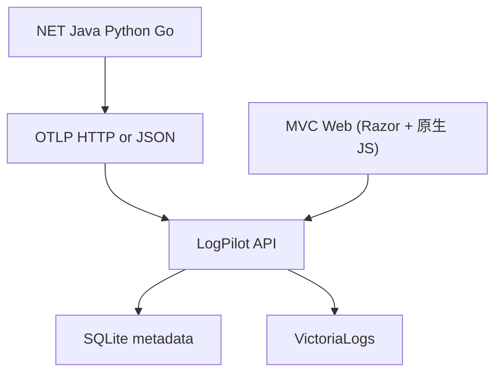
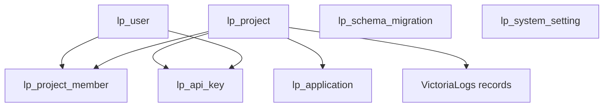

# LogPilot V0.1 数据库与日志数据模型设计

> 文档编号：02｜版本：V1.0｜日期：2026-10-13｜状态：开发基线草案  
> 上游：《01_LogPilot_V0.1_产品需求文档_PRD.md》；技术基线：LogPilot V2.7  
> 适用：ASP.NET Core 8 MVC + Web API、Dapper、Microsoft.Data.Sqlite、VictoriaLogs  
> 部署约束：LogPilot 和 VictoriaLogs 两个 Docker 容器；不引入 MySQL、Redis、RabbitMQ  
> Mermaid：使用 Typora 8.14.0 兼容的基础语法。

## 1. 设计目标和边界

LogPilot 的**管理元数据**由 SQLite 保存，**高频业务日志**由 VictoriaLogs 保存。不要把业务日志写入 SQLite；它只承担低频的账号、项目、密钥、授权和运行配置。首版实现 SDK/OTLP/HTTP Protobuf 和自定义 HTTP JSON 批量接入，二者转换成统一的内部日志模型。

关键约束：① 降低安装门槛；② 项目访问隔离由 LogPilot API 强制执行；③ 数据模型以实际日志查询为中心；④ 保留、备份与升级可操作；⑤ 数据隐私增强功能暂缓，但凭证安全和基本鉴权不可省略。

### 1.1 逻辑结构



| 存储 | 具体内容 | 生命周期 | 读写特点 |
|---|---|---|---|
| SQLite | 用户、项目、项目成员、服务、密钥、迁移记录、系统设置 | 长期 | 小量事务读写 |
| VictoriaLogs | 日志正文、时间、等级、服务、TraceId、异常、业务标签 | 依日志保留策略 | 高频批量追加、全文搜索、时间过滤和统计 |
| 容器数据卷 | SQLite 文件与 VictoriaLogs 数据 | 独立于容器 | 备份与迁移均必须覆盖 |

## 2. SQLite 配置规范

- 建议文件路径：`/app/data/logpilot.db`，映射到宿主机持久化目录；绝不写入容器临时文件层。
- 使用 `Microsoft.Data.Sqlite`（与 .NET 8 兼容的 8.x 版本）+ Dapper；连接字符串示例：`Data Source=/app/data/logpilot.db;Pooling=True;Default Timeout=5`。
- 每个新建连接执行 `PRAGMA foreign_keys = ON;`；数据库初始化执行 `PRAGMA journal_mode = WAL;`，并确认生效。
- `PRAGMA busy_timeout = 5000;` 可缓解短暂锁冲突；SQLite 同一时刻只有一个写事务，写操作应短小。
- `WAL`/`SHM` 为运行文件，**不能仅在运行中拷贝主 `.db` 文件就视作一致备份**；使用 SQLite Backup API 或正确的在线备份机制。
- 存储时间统一为 UTC，SQL 列存 ISO-8601 UTC 字符串（例如 `2026-10-13T03:00:00.000Z`），由 Repository 统一读写转换。不要混用本地时间。
- SQLite 没有原生的 `DATETIME`、`BOOLEAN` 强类型：约定状态和布尔值使用 `INTEGER`，日期使用 `TEXT` 并由应用校验。
- 所有 SQL 使用 Dapper 参数化，不允许字符串拼接动态过滤值。

## 3. 数据关系



> VictoriaLogs 中的 `project_id` 不是 SQLite 外键；必须由写入 API 从密钥绑定项目注入，不能直接相信客户端填写的项目字段。
> `lp_project_member.role` 取值为 `owner` / `admin` / `viewer`（`CHECK` 约束），主键为 `(project_id, user_id)`；项目可见性由该成员关系驱动。

## 4. SQLite 建表 SQL（V0.1 可执行初稿）

以下为**全新数据库**创建脚本；后续升级必须使用增量迁移，不要对已有库反复执行整段建表脚本。`CHECK`、唯一索引和外键约束用于控制基础数据质量。

```sql
PRAGMA foreign_keys = ON;
PRAGMA journal_mode = WAL;
PRAGMA busy_timeout = 5000;

BEGIN TRANSACTION;

CREATE TABLE IF NOT EXISTS lp_schema_migration (
    version INTEGER PRIMARY KEY,
    name TEXT NOT NULL,
    applied_at TEXT NOT NULL
);

CREATE TABLE IF NOT EXISTS lp_user (
    id INTEGER PRIMARY KEY AUTOINCREMENT,
    username TEXT NOT NULL COLLATE NOCASE,
    display_name TEXT NOT NULL DEFAULT '',
    password_hash TEXT NOT NULL,
    status INTEGER NOT NULL DEFAULT 1 CHECK (status IN (0, 1)),
    is_system_admin INTEGER NOT NULL DEFAULT 0 CHECK (is_system_admin IN (0, 1)),
    created_at TEXT NOT NULL,
    updated_at TEXT NOT NULL,
    last_login_at TEXT NULL
);
CREATE UNIQUE INDEX IF NOT EXISTS ux_lp_user_username ON lp_user(username);

CREATE TABLE IF NOT EXISTS lp_project (
    id INTEGER PRIMARY KEY AUTOINCREMENT,
    code TEXT NOT NULL COLLATE NOCASE,
    name TEXT NOT NULL,
    description TEXT NOT NULL DEFAULT '',
    status INTEGER NOT NULL DEFAULT 1 CHECK (status IN (0, 1)),
    created_by INTEGER NULL REFERENCES lp_user(id) ON DELETE SET NULL,
    created_at TEXT NOT NULL,
    updated_at TEXT NOT NULL
);
CREATE UNIQUE INDEX IF NOT EXISTS ux_lp_project_code ON lp_project(code);
CREATE INDEX IF NOT EXISTS ix_lp_project_status ON lp_project(status);

CREATE TABLE IF NOT EXISTS lp_project_member (
    project_id INTEGER NOT NULL REFERENCES lp_project(id) ON DELETE CASCADE,
    user_id INTEGER NOT NULL REFERENCES lp_user(id) ON DELETE CASCADE,
    role TEXT NOT NULL CHECK (role IN ('owner', 'admin', 'viewer')),
    created_at TEXT NOT NULL,
    PRIMARY KEY (project_id, user_id)
);
CREATE INDEX IF NOT EXISTS ix_lp_project_member_user ON lp_project_member(user_id);

CREATE TABLE IF NOT EXISTS lp_application (
    id INTEGER PRIMARY KEY AUTOINCREMENT,
    project_id INTEGER NOT NULL REFERENCES lp_project(id) ON DELETE CASCADE,
    service_name TEXT NOT NULL,
    display_name TEXT NOT NULL DEFAULT '',
    description TEXT NOT NULL DEFAULT '',
    status INTEGER NOT NULL DEFAULT 1 CHECK (status IN (0, 1)),
    created_at TEXT NOT NULL,
    updated_at TEXT NOT NULL,
    UNIQUE(project_id, service_name)
);
CREATE INDEX IF NOT EXISTS ix_lp_application_project ON lp_application(project_id);

CREATE TABLE IF NOT EXISTS lp_api_key (
    id INTEGER PRIMARY KEY AUTOINCREMENT,
    project_id INTEGER NOT NULL REFERENCES lp_project(id) ON DELETE CASCADE,
    name TEXT NOT NULL,
    key_prefix TEXT NOT NULL,
    key_hash TEXT NOT NULL UNIQUE,
    scope TEXT NOT NULL DEFAULT 'ingest' CHECK (scope IN ('ingest')),
    status INTEGER NOT NULL DEFAULT 1 CHECK (status IN (0, 1)),
    created_by INTEGER NULL REFERENCES lp_user(id) ON DELETE SET NULL,
    created_at TEXT NOT NULL,
    expires_at TEXT NULL,
    revoked_at TEXT NULL,
    last_used_at TEXT NULL
);
CREATE INDEX IF NOT EXISTS ix_lp_api_key_project_status ON lp_api_key(project_id, status);

CREATE TABLE IF NOT EXISTS lp_system_setting (
    setting_key TEXT PRIMARY KEY,
    setting_value TEXT NOT NULL,
    updated_at TEXT NOT NULL
);

INSERT OR IGNORE INTO lp_schema_migration(version, name, applied_at)
VALUES (1, 'init_v01', strftime('%Y-%m-%dT%H:%M:%fZ', 'now'));

COMMIT;
```

### 4.1 核心表说明

| 表 | 作用 | 关键规则 |
|---|---|---|
| `lp_user` | 本地管理员及成员登录 | `username` 唯一；密码只能保存带盐的安全哈希，禁止明文及自制 SHA-256 密码算法 |
| `lp_project` | 日志归属和访问边界 | `code` 稳定且唯一；停用后禁用写入 |
| `lp_project_member` | 项目用户权限 | `role` 取值为 `owner` / `admin` / `viewer`（`CHECK` 约束）；主键 `(project_id, user_id)`，同一用户在同一项目只有一条记录；所有查询必须检查授权 |
| `lp_application` | 服务展示及管理 | 同一项目内 `service_name` 唯一；可以来自入库服务名映射或显式创建 |
| `lp_api_key` | 机器接入令牌 | 高熵随机密钥、一次展示、保存哈希、支持撤销与过期；按项目绑定 |
| `lp_system_setting` | 低频全局设置 | 不存管理员密码或明文 Token |
| `lp_schema_migration` | 迁移版本 | 每个迁移执行一次，完成后写入版本 |

**项目可见性与成员规则**：
- 项目可见性由 `lp_project_member` 驱动：`ListAccessibleAsync` 只返回当前用户作为成员的项目；`lp_user.is_system_admin = 1` 的用户绕过该成员检查，可见全部项目。用户在项目内的 owner/admin/viewer 角色决定其在该项目能否管理 API Key 与应用。
- **零迁移**：本批「人员管理 + 项目隔离」能力未新增任何数据库迁移，完全复用现有表结构（`lp_user.is_system_admin` 与 `lp_project_member` 均已在 `0001_init.sql` 中定义）。同时已移除「创建项目时自动把创建者写为 owner 成员行」的写入，新项目成员由系统管理员显式配置。

### 4.2 密钥设计

建议密钥格式：`lp_` + 32 字节以上密码学安全随机字节编码。服务端只持久化密钥哈希，查询验证时结合固定长度比较和明确的密钥定位策略；`key_prefix` 仅用于页面识别，不能作为凭证。应用日志接入密钥只允许 `ingest` 操作，用户登录与管理 API 使用独立认证会话。创建、撤销和过期检测必须以数据库中的项目状态为准。

### 4.3 告警相关表（V0.2）

V0.2 新增三张告警表（迁移 `0002_alerting.sql`），后续迁移 `0003_alert_enhancements.sql` 扩展了规则的条件类型与静默期：

| 表 | 用途 |
|---|---|
| `lp_alert_channel` | 通知渠道（钉钉 / 企微 / 邮件 / Webhook），配置 JSON AES 加密存储 |
| `lp_alert_rule` | 告警规则（匹配范围、计数/占比阈值、窗口、冷却、渠道关联、静默期） |
| `lp_alert_event` | 告警事件实例（状态、首次/最近触发、确认/恢复、指纹去重） |

关键字段：
- `lp_alert_channel`：`id`、`project_id`、`name`、`type`、`config_encrypted`、`enabled`、`created_at`、`updated_at`
- `lp_alert_rule`：`id`、`project_id`、`name`、`service_name`、`levels`(JSON)、`keyword`、`condition_type`、`threshold`、`window_minutes`、`cooldown_minutes`、`repeat_minutes`、`channel_ids`(JSON)、`severity`、`notify_recovery`、`enabled`、`silence_until`
- `lp_alert_event`：`id`、`project_id`、`rule_id`、`fingerprint`、`status`、`severity`、`summary`、`first_fired_at`、`last_fired_at`、`acknowledged_at`、`resolved_at`、`last_notified_at`、`notified_count`

约束与取值：
- `lp_alert_rule.condition_type`：`count`（匹配条数）或 `ratio`（匹配日志占同服务范围全部日志的百分比）
- `lp_alert_rule.silence_until`：静默截止时间（TEXT，UTC）；`NULL` 表示未静默。静默期内命中不发通知
- `lp_alert_event.status`：`firing`、`acknowledged`、`silenced`、`resolved`

> `0003_alert_enhancements.sql` 因需修改 CHECK 约束而重建表，使用 `-- @no-transaction` 标记自行控制事务（`PRAGMA foreign_keys` 在事务内无效）。

### 4.4 后续版本的表（不要过早创建）

- `lp_audit_log`：对应 V0.3 的审计。表结构在相应功能进入开发前再冻结。
- `lp_error_group`：**不再需要**。异常指纹与重复问题聚合已实现为查询期聚合（`GET /api/v1/stats/exceptions` 通过 LogsQL 按指纹归并），不落库、不建表。

## 5. VictoriaLogs 统一日志字段设计

VictoriaLogs 不使用 SQLite 式的建表 SQL。LogPilot 将事件标准化为**日志字段集合**，通过其摄入 API 写入。

| 字段 | 类型示意 | 来源 / 用途 |
|---|---|---|
| `_time` | 时间 | 事件时间，UTC；不存在则记录接收时间并附标识 |
| `_msg` | 文本 | 日志消息，全文检索主体 |
| `project_id` | 字符串 | **由 LogPilot 根据已认证 Token 注入**，不能信任客户端值 |
| `service_name` | 字符串 | OTLP `service.name` 或 JSON `serviceName` |
| `environment` | 字符串 | 运行环境，如 production/test |
| `level` | 字符串 | 规范化为 TRACE/DEBUG/INFO/WARN/ERROR/FATAL |
| `trace_id` | 字符串 | 可选，关联一次请求 |
| `span_id` | 字符串 | 可选，关联 Span |
| `event_id` | 字符串 | 客户端给出或服务端生成，供排查与重复事件识别；**不承诺底层自动唯一去重** |
| `host_name` | 字符串 | 节点标识，可选 |
| `exception_type` | 字符串 | 异常类型，可选 |
| `exception_stack` | 文本 | 异常堆栈，可选 |
| `attributes` | 扩展字段 | 自定义键值，需控制数量、名称和单条大小 |
| `received_at` | 时间 | LogPilot 接收时间，用于计算延迟 |

### 5.1 字段映射示例

SDK（OTLP Protobuf）请求中的 `ResourceLogs` 与 `LogRecord` 被转换为上述字段。保留重要 resource/scope 信息，但不直接把全部复杂嵌套结构无约束写入动态字段。

自定义 JSON 示例（客户端提交，不含可信 `project_id`）：

```json
{
  "logs": [
    {
      "timestamp": "2026-10-13T03:00:00Z",
      "serviceName": "hilink-api",
      "environment": "production",
      "level": "Error",
      "message": "MySQL connection timeout",
      "traceId": "4bf92f3577b34da6a3ce929d0e0e4736",
      "attributes": { "module": "OrderService" }
    }
  ]
}
```

服务器处理后映射到 VictoriaLogs 的示例（仅说明字段，不是 OTLP 原始报文）：

```json
{
  "_time": "2026-10-13T03:00:00Z",
  "_msg": "MySQL connection timeout",
  "project_id": "1",
  "service_name": "hilink-api",
  "environment": "production",
  "level": "ERROR",
  "trace_id": "4bf92f3577b34da6a3ce929d0e0e4736",
  "module": "OrderService"
}
```

### 5.2 Stream 字段与高基数

建议对 VictoriaLogs 设置 stream fields 为 `project_id,service_name,environment`。不得把 `trace_id`、`event_id`、`request_id`、`user_id` 这类高基数字段设为 stream fields，否则会制造大量独立 streams，增加索引和查询开销。实际字段组合需要用真实数据压测。官方支持摄入时使用 `_stream_fields`、`_time_field`、`_msg_field` 来指定字段。

## 6. 写入与查询契约

### 6.1 写入 API 对应关系

| 外部入口 | 类型 | LogPilot 动作 | VictoriaLogs 适配 |
|---|---|---|---|
| `POST /v1/logs` | OTLP/HTTP Protobuf | 解析 ExportLogsServiceRequest，认证、字段映射、批量转发 | 可调用 `/insert/opentelemetry/v1/logs`，但为强制项目字段需正确重建映射；或统一转 NDJSON |
| `POST /api/v1/ingest/logs` | 自定义 JSON | 验证数组及属性、规范化字段 | `/insert/jsonline`（NDJSON） |

**重要**：不要直接把未经授权的客户端 OTLP 原样透传给 VictoriaLogs，否则无法安全、统一地注入项目标识并检查配额。OTLP 接口应按协议返回正常响应或标准的错误/部分成功反馈。对于 JSONL 的部分坏行，VictoriaLogs 可能跳过无效行继续处理；LogPilot 应在转发前完成整批校验，避免把后端的接受响应误判为全部日志成功入库。

### 6.2 查询约定

官方查询 HTTP 路径：`/select/logsql/query`，`query` 参数传递 LogsQL。查询须服务端构造、强制加上当前授权项目与时间范围。LogsQL 本身是查询语言，不是 SQL；不要允许普通页面直接提交没有任何约束的 LogsQL。

示例（字段名以标准化模型为准）：

```text
_time:1h {project_id="1",service_name="hilink-api"} level:ERROR
```

```text
_time:1h {project_id="1"} timeout | sort by (_time desc) | limit 100
```

```text
_time:1h {project_id="1"} | stats by (level) count() as total
```

以上为日志过滤与聚合示意；查询构造器仍须处理词元转义、时间窗口、服务名、返回条数与 LogsQL 语法校验。无时间限制或无项目过滤的查询在普通用户接口中应直接拒绝。

### 6.3 隔离和信任边界

- VictoriaLogs 端口只允许 LogPilot 容器及受信任运维网络访问，**不对外直接暴露 9428**。
- 所有浏览器管理查询在 API 侧验证用户对 `project_id` 的访问权限。
- 接入 Token 只对应一个项目；客户端的 `project_id` 属性必须忽略或拒绝，不得覆盖服务端注入值。
- 不允许用户通过任意 LogsQL 字符串消除项目限制。V0.1 只暴露结构化筛选条件。
- 对大范围查询设置时间跨度、最大行数、超时和并发上限。
- **字段级项目隔离不是 VictoriaLogs 提供的强安全多租户边界**；当前模型成立的前提是 LogPilot 唯一入口、数据库网络隔离，以及服务端不可绕过的过滤。

## 7. 数据保留和清理

- VictoriaLogs 使用服务端 `-retentionPeriod=7d` 作为首版**全局默认保留时间**；此参数与项目表无关，不承诺 V0.1 项目级不同 TTL。
- 如需磁盘软阈值，可配置 `-retention.maxDiskSpaceUsageBytes=5GiB`（仅示例，可调），并记录容量告警；它不是严格的磁盘配额，实际容量可能短暂超过阈值。
- SQLite 的项目、用户、配置无 7 天自动删除逻辑。
- 明确说明日志存储保留不是备份：误删、损坏、宿主机故障需要独立备份恢复方案。

## 8. 迁移、备份和恢复

### 8.1 SQLite 迁移

- 将每次迁移写成 `migrations/0001_init.sql` 等文件，启动时获取迁移互斥、开启事务（需注意 WAL PRAGMA 必须在事务外），检查版本后执行。
- 所有迁移在测试副本上先演练；SQLite 某些结构变更需要“新表—复制—替换”流程。
- 不得修改已应用迁移的内容，新增补丁迁移修复问题。

### 8.2 备份

1. SQLite：采用 SQLite 官方 Backup API 或一致快照，验证生成的备份文件可正常打开、`PRAGMA integrity_check` 通过。
2. VictoriaLogs：遵循官方支持的备份方法和文件快照前提；不要在运行中直接拷贝数据目录后宣称一致。
3. 保管 API Key / 登录配置所依赖的服务器密钥；恢复前验证配置与数据版本匹配。
4. 恢复演练至少覆盖：空机器部署、还原用户项目、日志索引数据可查询。

## 9. 性能与测试

| 验收项 | 测试要求 |
|---|---|
| SQLite | 100 并发查询、账号/密钥小量写入，检查锁等待和事务一致性 |
| 写入 | 批次 100/500、不同日志大小，记录日志/秒、CPU、内存、失败次数 |
| 搜索 | 100 万与 1000 万日志规模下，测试时间+项目+服务+关键词 |
| 中文 | 测试“登录失败”等中文短语的词元匹配与子字符串模式 |
| 安全 | 不同 Token 的项目隔离；恶意字段中伪造 project_id 不生效 |
| 故障 | VictoriaLogs 停机、恢复、网络超时、重复提交，记录可见结果 |
| 重启 | 两个容器升级重建后元数据与日志仍可恢复 |

性能目标必须在指定硬件、平均消息大小、索引/stream 组合和并发水平上实测，不将特定机器配置列为产品定位要求。

## 10. 开发交付顺序

1. 完成 SQLite 迁移加载器、账号/项目/成员/Token Repository。
2. 实现 JSON 批量接收、统一模型、VictoriaLogs NDJSON 写入与回查。
3. 实现 OTLP Protobuf 接入并复用统一转换服务。
4. 实现 LogsQL 安全查询构造与分页/限流。
5. 完成管理员初始设置、基本页面查询、跨项目权限测试。
6. 开发端到端测试与备份恢复验证；再进行发布。

## 11. 开发待确认的少量决策

- SQLite 管理员密码哈希推荐 ASP.NET Core `PasswordHasher<TUser>`（或成熟 Argon2id 库），首版统一一种实现并提供参数升级策略。
- `service_name` 未预先注册时，是自动登记到 `lp_application`（可能增加写锁和高基数风险），还是仅展示出现过的服务：**建议 V0.1 只从日志中检索展示，显式保存服务备注时才写入 SQLite**。
- 多项目的日志保留时长：V0.1 使用全局保留，后续确有需求再引入项目级删除策略。
- 日志分页：VictoriaLogs 查询结果可流式输出，但跨页排序稳定性及游标语义需经测试设计，不直接照搬关系数据库 OFFSET。

## 12. 官方参考链接

- VictoriaLogs 摄入：<https://docs.victoriametrics.com/victorialogs/data-ingestion/>
- VictoriaLogs 查询：<https://docs.victoriametrics.com/victorialogs/querying/>
- VictoriaLogs LogsQL：<https://docs.victoriametrics.com/victorialogs/logsql/>
- SQLite WAL：<https://sqlite.org/wal.html>
- Microsoft.Data.Sqlite：<https://learn.microsoft.com/dotnet/standard/data/sqlite/>
- OpenTelemetry OTLP：<https://opentelemetry.io/docs/specs/otlp/>

---

**文档完成定义**：SQLite 核心表和索引可在空库执行，OTLP 与 JSON 的字段契约明确，所有日志查询必须绑定项目与时间，首次部署不需要新增数据库服务。下一份文档：`03_LogPilot_V0.1_API接口设计.md`。
