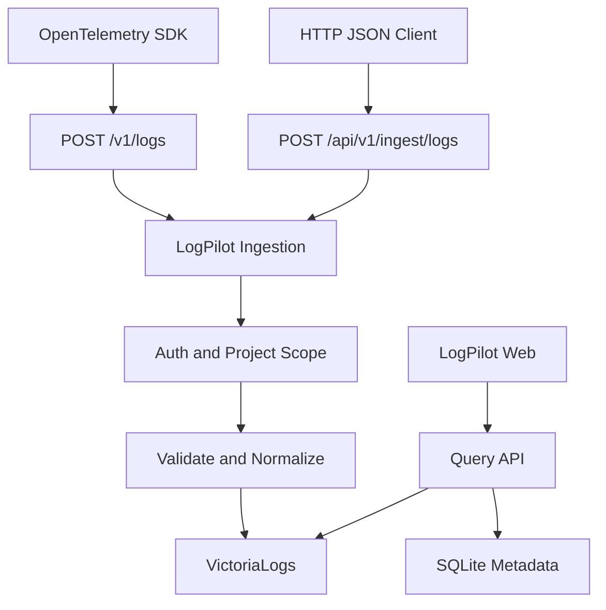
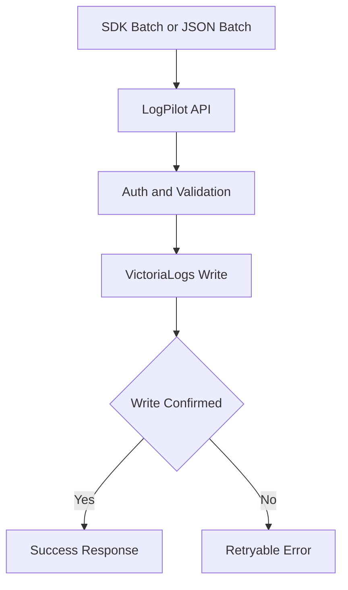

# LogPilot V0.1 API 接口设计

> 文档版本：V1.0（配套 LogPilot 技术方案 V2.7）  
> 更新日期：2026-10-13  
> 状态：开发设计基线，示例接口尚未实现  
> 适用技术：ASP.NET Core 8 MVC + Web API、Dapper + SQLite、VictoriaLogs、Razor + Vue 3  
> 核心原则：轻量化、部署简单化、使用方便化；两个 Docker 容器，无 RabbitMQ。

## 1. 文档目标与范围

本文定义 LogPilot V0.1 的外部接入、管理及查询 API，并约定鉴权、字段标准化、错误处理、分页、写入语义与测试验收。LogPilot 允许两种入口：

1. **主要入口：OpenTelemetry SDK → OTLP/HTTP Protobuf**（`POST /v1/logs`）；适合 .NET、Java、Python、Go、Node.js 等长期运行的项目。日志由 SDK 异步批量导出。
2. **辅助入口：HTTP JSON 批量 API**（`POST /api/v1/ingest/logs`）；适合脚本、旧应用与简单集成。客户端应自行处理批量、限速和重试。

两者统一认证、校验、归一化及写入 VictoriaLogs。**V0.1 仅要求日志（Logs）信号**，不承诺 `/v1/traces`、`/v1/metrics` 或 OTLP/gRPC。

## 2. 系统边界

- **LogPilot**：ASP.NET Core 8 单个进程，同时托管 MVC Razor 页面、Vue 静态脚本、JSON 管理 API、OTLP 接入、后台告警任务；SQLite 保存项目、用户、密钥与配置。
- **VictoriaLogs**：第二个容器，提供真正的日志存储与 LogsQL 查询；在私有 Docker 网络中访问，**不对公网暴露 VictoriaLogs 管理/查询端口**。
- **客户端**：使用 SDK 或 HTTP 请求，不要求安装 RabbitMQ、Kafka、Redis 等中间件。



图表只采用 Typora Mermaid 8.14.0 支持的基础语法。

## 3. 路由与版本约定

| 路由类别 | 前缀 | 说明 |
|---|---|---|
| 标准 OTLP Logs | `/v1/logs` | 与 OTLP 标准保持兼容，不改为 `/api/v1` |
| 简单日志写入 | `/api/v1/ingest` | LogPilot 私有 JSON API |
| 管理与查询 | `/api/v1` | 项目、应用、密钥、日志查询 |
| 健康检查 | `/health` | 供部署检查，详细信息需要授权 |
| MVC 页面 | `/`、`/logs`、`/projects` 等 | 返回 Razor 页面，调用同源 Web API |

- API 的日期时间均采用 ISO 8601 UTC（如 `2026-10-13T03:00:00Z`），内部存储可用 UTC 时间戳。
- JSON 使用 `camelCase`；列表与 JSON 接口返回 `application/json; charset=utf-8`。
- 不允许以 URL 查询参数传 API Key；推荐 `Authorization: Bearer <token>` 或 SDK 自定义 Header。
- 对管理 API 采用会话 Cookie 或受控管理令牌，不与日志接入密钥混用。
- 每个请求生成 `X-Request-Id`，便于定位问题。

## 4. 认证与项目隔离

### 4.1 两套独立凭据

| 凭据 | 适用接口 | 权限 |
|---|---|---|
| Ingest API Key | `/v1/logs`、`/api/v1/ingest/logs` | 只能向绑定项目写日志 |
| 管理员会话（HttpOnly Cookie） | `/api/v1/projects`、`/api/v1/logs` 等 | 根据 SQLite 项目成员角色读取/管理 |

API Key 由 SQLite 的 `lp_api_key` 表管理；密钥仅展示一次，服务端存储哈希，可撤销、到期。不要写在文档、镜像、GitHub 或生产日志中。

### 4.2 隔离规则

1. 日志摄入时，`project_id` **由服务端根据 API Key 注入**。任何客户端传入的 `projectId`、`project_id`、同名 OTLP Attribute 都不得覆盖服务端认定的项目。
2. 管理查询时，项目 ID 从请求中指定，但**必须经服务端成员/管理员权限验证**后再构建 LogsQL。
3. VictoriaLogs 仅通过内网由 LogPilot 访问，避免客户绕过 LogPilot 查询别的项目。
4. 首版使用明确的结构化 `project_id` 字段实现隔离；若以后采用 VictoriaLogs 原生多租户 Header，需对读写双方同时映射并回归验证。
5. 用户可传入 `service.name`、`deployment.environment.name` 等资源信息，但项目标识、摄入时间、服务器接收状态由平台决定。

### 4.3 权限模型

| 角色 | 项目查看与日志查询 | 管理项目成员 | 创建/吊销接入 Key |
|---|---|---|---|
| Viewer | 是 | 否 | 否 |
| Editor | 是 | 否 | 经项目策略授权 |
| Owner | 是 | 是 | 是 |
| Platform Admin | 全部项目 | 是 | 是 |

V0.1 如仅落地管理员和 Viewer 两种角色，应在 UI 中隐藏尚未实现的权限功能，不得仅依靠前端控制。

## 5. OTLP/HTTP Protobuf 日志摄入（主要入口）

### 5.1 请求规范

```http
POST /v1/logs HTTP/1.1
Host: logs.example.com
Authorization: Bearer <INGEST_API_KEY>
Content-Type: application/x-protobuf
Content-Encoding: gzip
```

- 请求体为 **`ExportLogsServiceRequest` 二进制 Protobuf**，采用 OpenTelemetry 官方 proto 定义；不能简单把自定义 JSON 序列化为 Protobuf 就当成 OTLP。
- 支持原始 Protobuf，gzip 作为可选压缩；解压后仍检查大小限制，防止压缩炸弹。
- 默认接收端口可直接使用 LogPilot 的 HTTPS 端口；**不强制另外开放 4318**。若要与 OTLP 默认端口兼容，可以在配置中映射 `4318` 到同一 ASP.NET Core 服务。
- SDK 指定完整地址 `https://logs.example.com/v1/logs` 或按 SDK 语义使用 OTLP 基础地址与 Logs 路径。
- V0.1 仅实现 `Logs`，Traces/Metrics 请求应给出明确不支持提示。

### 5.2 SDK 配置示意

```bash
OTEL_EXPORTER_OTLP_LOGS_ENDPOINT=https://logs.example.com/v1/logs
OTEL_EXPORTER_OTLP_LOGS_PROTOCOL=http/protobuf
OTEL_EXPORTER_OTLP_LOGS_HEADERS=Authorization=Bearer%20YOUR_INGEST_API_KEY
```

> 环境变量 Header 的转义语法依 SDK 实现而异。上述为配置示意，不作为所有语言可复制的唯一写法。每个语言示例需要安装并启用日志 SDK/Exporter，同时按其文档设置身份凭据。

### 5.3 响应语义（必须遵循 OTLP 标准）

- **全部成功**：`HTTP 200`，`Content-Type: application/x-protobuf`，响应体为 `ExportLogsServiceResponse`，`partial_success` 字段不设置。
- **部分成功**：`HTTP 200`，仍然返回 `ExportLogsServiceResponse`，设置 `partial_success.rejected_log_records` 和 `error_message`。**SDK 不应对部分成功自动重试整批请求**。
- **全部失败**：`HTTP 4xx/5xx`；对于 Protobuf 请求，响应体为符合 OTLP 的 Protobuf `google.rpc.Status`，不是 LogPilot 自定义 JSON 响应结构。
- 429/503 等可重试错误，支持标准 `Retry-After`。无效鉴权、格式错误属于非重试场景。
- 当 VictoriaLogs 写入结果不可确认时，返回可重试错误而不是伪造 200。超时重试可能产生重复日志，V0.1 不保证端到端 exactly-once。

### 5.4 服务端字段转换

| OTLP 字段 | LogPilot 字段 | 注意 |
|---|---|---|
| `Resource.attributes[service.name]` | `service_name` | 无值时使用受控默认值 |
| `Resource.attributes[deployment.environment.name]` | `environment` | 可选 |
| `LogRecord.time_unix_nano` | `_time` | 缺失时回退 `observed_time_unix_nano`，仍缺失再用服务端接收时间 |
| `LogRecord.severity_text` / `severity_number` | `level` | 映射到 Trace/Debug/Info/Warn/Error/Fatal |
| `LogRecord.body` | `_msg` | 非字符串类型按受控 JSON 规则序列化 |
| `LogRecord.trace_id` | `trace_id` | 规范化十六进制 |
| `LogRecord.span_id` | `span_id` | 规范化十六进制 |
| `LogRecord.attributes` | 属性字段 | 限制字段数、深度和体积 |
| API Key 绑定项目 | `project_id` | 不信任传入值 |

完整 OTLP 语义包含多个 `resource_logs` / `scope_logs` / `log_records` 层级，必须逐条解析，不得默认一个请求仅含一个服务或一个 Scope。

## 6. HTTP JSON 批量日志摄入（辅助入口）

### 6.1 路由

`POST /api/v1/ingest/logs`

```http
POST /api/v1/ingest/logs HTTP/1.1
Authorization: Bearer <INGEST_API_KEY>
Content-Type: application/json
```

```json
{
  "logs": [
    {
      "timestamp": "2026-10-13T03:00:00Z",
      "serviceName": "payment-api",
      "environment": "production",
      "level": "Error",
      "message": "Database connection timeout",
      "traceId": "4bf92f3577b34da6a3ce929d0e0e4736",
      "attributes": {"module": "Payments", "durationMs": 1200}
    }
  ]
}
```

### 6.2 成功响应

```json
{
  "requestId": "req_01JEXAMPLE",
  "accepted": 1,
  "rejected": 0,
  "status": "accepted",
  "errors": []
}
```

`accepted` 表示写入路径已收到并成功取得 VictoriaLogs 接口确认，**不是承诺磁盘 fsync、强一致或永久不丢失**。V0.1 不采用服务端仅入内存 Channel 就返回成功的实现。

部分成功时可返回 `200` 并列出逐条错误（按原始数组序号），但调用方必须只重试失败且可重试的项；如果整批存储失败则返回 503。此 JSON 接口的响应不是 OTLP 标准响应。

### 6.3 建议的默认限制（均可配置、待压测）

| 项目 | 默认值建议 |
|---|---|
| 单批日志数 | 500 条 |
| 请求体上限（解压后） | 1 MiB（JSON API） |
| 单条日志大小 | 64 KiB |
| 最大属性个数 | 64 个 |
| 最大嵌套深度 | 8 |
| 写入 VictoriaLogs 超时 | 5 秒（视环境调整） |
| 服务端并发写入 | 有界并发，过载拒绝 |

以上属于 **LogPilot 私有 JSON API** 初始策略。OTLP 路径遵循自身协议规范，两个端点的大小限制可分别配置，避免未经说明地将私有 JSON 限额直接套用于标准 OTLP SDK。

## 7. 统一错误规范

### 7.1 LogPilot 管理 API / JSON API

```json
{
  "code": "PROJECT_ACCESS_DENIED",
  "message": "无权访问该项目",
  "requestId": "req_01JEXAMPLE",
  "details": null
}
```

| HTTP | 错误码示例 | 含义 / 客户端动作 |
|---|---|---|
| 400 | `INVALID_ARGUMENT` | 请求格式或字段非法，不重试原始请求 |
| 401 | `UNAUTHORIZED` | 未登录或接入 Key 无效 |
| 403 | `PROJECT_ACCESS_DENIED` | 没有对应项目权限 |
| 404 | `NOT_FOUND` | 资源不存在，避免泄露其他项目资源 |
| 409 | `CONFLICT` | 名称或状态冲突 |
| 413 | `PAYLOAD_TOO_LARGE` | 缩小批次，不直接重试 |
| 429 | `RATE_LIMITED` | 根据 `Retry-After` 退避 |
| 500 | `INTERNAL_ERROR` | 服务端错误，查看 requestId |
| 503 | `STORAGE_UNAVAILABLE` | 存储不可用，可限次退避重试 |
| 504 | `STORAGE_TIMEOUT` | 下游超时；写入是否成功可能未知，重试应考虑重复 |

### 7.2 OTLP 特殊约定

OTLP 错误不得照搬上述自定义 JSON 结构。该端点使用标准 Protobuf 响应/错误消息，并区分可重试与不可重试 HTTP 状态。完整实现依照 OpenTelemetry OTLP specification。

## 8. 登录、项目、应用、密钥管理 API

V0.1 提供以下最小管理接口；列表默认按当前用户有权访问的项目过滤。

| 方法 | 路径 | 说明 |
|---|---|---|
| `POST` | `/api/v1/auth/login` | 用户登录，建立安全会话 |
| `POST` | `/api/v1/auth/logout` | 登出与会话失效 |
| `GET` | `/api/v1/auth/me` | 当前用户信息 |
| `GET` | `/api/v1/projects` | 可访问项目列表 |
| `POST` | `/api/v1/projects` | 创建项目 |
| `GET` | `/api/v1/projects/{id}` | 项目详情 |
| `PATCH` | `/api/v1/projects/{id}` | 修改名称和基础配置 |
| `GET` | `/api/v1/projects/{id}/applications` | 应用列表 |
| `POST` | `/api/v1/projects/{id}/applications` | 新增应用 |
| `GET` | `/api/v1/projects/{id}/api-keys` | Key 元数据列表，不返回明文 |
| `POST` | `/api/v1/projects/{id}/api-keys` | 生成接入 Key，仅返回一次明文 |
| `DELETE` | `/api/v1/projects/{id}/api-keys/{keyId}` | 吊销 Key |

### 8.1 创建项目

```http
POST /api/v1/projects
Content-Type: application/json
```

```json
{"name":"HiLink","code":"hilink","description":"业务日志"}
```

```json
{
  "id": "prj_001",
  "name": "HiLink",
  "code": "hilink",
  "createdAt": "2026-10-13T03:00:00Z"
}
```

`code` 在系统内唯一；修改 code 时应明确是否影响已有 Key 和日志查询，不允许静默破坏关联。数据库 ID 可继续用整数，API 对外标识应在实现前统一固定。

### 8.2 创建 API Key

```json
{"name":"hilink-api-prod","expiresAt":null}
```

```json
{
  "id": "key_001",
  "name": "hilink-api-prod",
  "prefix": "lp_abc123",
  "apiKey": "lp_<一次性随机密钥>",
  "createdAt": "2026-10-13T03:00:00Z"
}
```

`apiKey` 只在本次创建响应中返回，之后仅可查看 `prefix`、创建时间、过期时间和状态。

## 9. 日志查询 API（LogPilot → VictoriaLogs）

### 9.1 查询 API 一览

| 方法 | 路径 | 说明 |
|---|---|---|
| `POST` | `/api/v1/logs/search` | 按时间、服务、级别和关键词筛选 |
| `GET` | `/api/v1/logs/{id}` | 通过可定位的日志 ID 获取详情（见限制） |
| `GET` | `/api/v1/logs/context` | 查询某时间点周边日志 |
| `GET` | `/api/v1/logs/filters` | 服务、级别等筛选候选值 |
| `GET` | `/api/v1/stats/overview` | 总量、错误数等概览 |
| `GET` | `/api/v1/stats/trend` | 时间段聚合趋势 |
| `GET` | `/api/v1/logs/tail` | V0.2 规划：SSE 实时日志 |

### 9.2 日志搜索请求

```http
POST /api/v1/logs/search
Content-Type: application/json
```

```json
{
  "projectId": "prj_001",
  "startTime": "2026-10-13T02:00:00Z",
  "endTime": "2026-10-13T03:00:00Z",
  "services": ["hilink-api"],
  "levels": ["Error", "Fatal"],
  "keyword": "timeout",
  "traceId": null,
  "pageSize": 100,
  "cursor": null
}
```

```json
{
  "items": [
    {
      "id": "evt_01JEXAMPLE",
      "timestamp": "2026-10-13T02:59:00Z",
      "serviceName": "hilink-api",
      "level": "Error",
      "message": "Database connection timeout",
      "traceId": "4bf92f3577b34da6a3ce929d0e0e4736"
    }
  ],
  "nextCursor": null,
  "hasMore": false
}
```

**分页限制**：VictoriaLogs 不提供 LogPilot 可以直接照搬的全局稳定游标。首版优先采用“时间锚点 + 稳定事件 ID”实现有界向后翻页，服务端构造下一页时间约束并进行本地去重；同一时间戳下的稳定顺序必须通过集成测试验证。若不能确保稳定无遗漏，V0.1 应限制为最近 N 条 + 向前加载，而不是虚假承诺任意深度稳定分页。

日志 `id` 应由 LogPilot 产生或根据明确策略映射外部标识；如果从标准 OTLP 导入并无稳定 ID，系统必须补充事件 ID。ID 不能当作 VictoriaLogs 原生主键。

### 9.3 LogsQL 查询生成原则

LogPilot 在服务端构建 LogsQL：

- 总是先验证项目访问权限；插入强制 `project_id` 过滤。
- 默认选择最近 15 分钟，可配置最长查询窗口。
- 使用受控字段白名单组合筛选，不允许客户端任意插入完整 LogsQL 片段。
- 查询参数和自由文本先按 LogsQL 语法安全转义，防止表达式注入。
- 限制结果条数、查询超时和并发；详情页不允许无限范围搜索。

VictoriaLogs 正式查询接口：`POST http://victorialogs:9428/select/logsql/query`，表单参数包含 `query`；也支持 `/select/logsql/tail`、`/select/logsql/hits`、`/select/logsql/facets` 和 `/select/logsql/stats_query`，但这些是 **后端内部接口**，不得直接暴露给浏览器。

> LogsQL 的字段名、管道、引号与查询算子应以固定版本的 VictoriaLogs 官方语法进行集成测试。本 API 以逻辑过滤表达式为契约，不要求前端直接传 LogsQL。

### 9.4 统计请求

```http
GET /api/v1/stats/trend?projectId=prj_001&from=2026-10-13T02%3A00%3A00Z&to=2026-10-13T03%3A00%3A00Z&interval=5m
```

```json
{
  "interval": "5m",
  "points": [
    {"time":"2026-10-13T02:00:00Z","count":128,"errors":8},
    {"time":"2026-10-13T02:05:00Z","count":140,"errors":12}
  ]
}
```

统计结果需考虑数据延迟、无日志时间桶补零和时间范围边界（推荐 `[start, end)`）。

## 10. VictoriaLogs 内部写入与查询适配器

### 10.1 内部接口

| 方向 | VictoriaLogs 接口 | 用途 |
|---|---|---|
| OTLP 写入 | `POST /insert/opentelemetry/v1/logs` | VictoriaLogs 原生 OTLP 接入 |
| JSON 行写入 | `POST /insert/jsonline` | LogPilot 自定义 JSON 标准化写入 |
| 日志查询 | `POST /select/logsql/query` | LogsQL 查询 |
| 实时尾随 | `/select/logsql/tail` | 后续 SSE 适配 |
| 字段分面 | `/select/logsql/facets` | 筛选候选项 |
| 统计 | `/select/logsql/stats_query`、`/select/logsql/hits` | 趋势/聚合 |

**实现决策**：两种客户端接入统一经过 LogPilot 校验和字段规范化。V0.1 优先选择服务端内部一种确定的写入格式（例如 JSON Lines），通过 `VictoriaLogsWriter` 一次适配，避免同时维护两套字段映射逻辑。若采用直接转发 OTLP，必须安全地补充项目字段和权限信息，不能跳过归一化。

### 10.2 建议内部接口

```csharp
public interface ILogIngestService
{
    Task<IngestResult> IngestAsync(
        IReadOnlyList<NormalizedLog> logs,
        CancellationToken cancellationToken);
}

public interface ILogStore
{
    Task<StoreWriteResult> WriteBatchAsync(
        IReadOnlyList<NormalizedLog> logs,
        CancellationToken cancellationToken);

    Task<LogSearchResult> SearchAsync(
        LogSearchRequest request,
        CancellationToken cancellationToken);
}
```

对 `HttpClient` 使用 `IHttpClientFactory` 管理连接池，设置超时与限并发。不要每收到一条日志就创建新的 `HttpClient` 或向 VictoriaLogs 逐条发请求。

## 11. 写入可靠性、限流与背压

### 11.1 简化首版处理链



- **不使用 RabbitMQ，也不自研复杂 WAL 作为 V0.1 前置条件**。
- LogPilot 不应在“仅放进内存”时返回成功。至少等待后端写入 API 的明确确认。
- VictoriaLogs 的确认不应被夸大为永久持久化承诺，考虑其内部缓存/刷盘策略。
- 客户端 SDK 采用批量导出、有界缓冲与退避重试。应用主业务线程不应同步等待每条日志请求完成。
- LogPilot 实现并发上限、请求体限制、鉴权限流和短时故障保护；过载时返回 429/503，不应无限积压内存。
- 网络超时存在“数据库已写入但回复丢失”的可能，重试产生重复需要在产品文档中说明，必要时提供事件 ID 去重策略。
- 支付、审计等关键业务记录不能仅依赖尽力而为的应用日志，需要业务事务或专门的审计记录体系。

### 11.2 退避约定

客户端对 `429`、`503` 和符合标准的临时错误使用指数退避 + 抖动，优先遵守 `Retry-After`。对 `400`、`401`、`403`、`413` 不盲目重试；OTLP `partial_success` 遵循协议，不重试已部分接受的整批请求。

## 12. 安全与 Web API 约定

- 生产默认要求 TLS，管理 Cookie 设置 `Secure`、`HttpOnly`、适当 `SameSite`。
- MVC 同源状态变更接口启用防伪校验（CSRF）；使用 Bearer Token 的摄入接口不以 Cookie 认证。
- SQLite 用户密码使用成熟密码哈希器；不得明文存储。
- API Key 仅用于数据接入，不能查询日志或管理用户。
- 访问密钥、密码、HTTP Authorization、数据库连接串等应在日志进入 VictoriaLogs 前脱敏。
- 请求、查询、导出都执行授权，避免通过查询接口绕过项目隔离。
- VictoriaLogs 端口仅 Docker 内网访问，API 代理不能变成任意目标地址的 SSRF 中转。

## 13. 接口验收与自动化测试

| 编号 | 场景 | 验收标准 |
|---|---|---|
| API-001 | OTLP Protobuf 正常写入 | 返回正确的标准 `ExportLogsServiceResponse`，日志可搜索 |
| API-002 | OTLP gzip 数据 | 正常解压并限制解压后大小 |
| API-003 | OTLP 无效 Protobuf | 返回标准 OTLP 4xx 错误 |
| API-004 | OTLP 部分拒绝 | `partial_success.rejected_log_records` 正确，不要求 SDK 整批重试 |
| API-005 | JSON 批量写入 | 500 条以内的有效批次成功，记录项目来自 Key |
| API-006 | JSON 混合非法数据 | 明确逐条错误、计数和重试语义 |
| API-007 | 跨项目写入伪造 | 客户端 projectId 无法覆盖 Key 项目 |
| API-008 | 跨项目查询 | 无权限时拒绝，数据库查询不会越界 |
| API-009 | VictoriaLogs 不可用 | 不返回假成功，客户端得到可重试错误 |
| API-010 | 写入高峰 | 并发有界、不会持续增大内存、错误可观测 |
| API-011 | 关键词和时间查询 | 与测试日志预期一致，包括中文短语 |
| API-012 | 分页边界 | 同时间戳、并发新增日志时不伪造稳定性保证 |
| API-013 | Key 撤销和过期 | 撤销后不能继续写入 |
| API-014 | 前端 Cookie CSRF | 未携带防伪凭据的变更请求被拒绝 |
| API-015 | LogPilot 健康检查 | 存活与下游可用状态分别返回 |

建议在 GitHub Actions 的集成测试中启动 VictoriaLogs 固定版本 Docker 容器，使用真实 SDK Protobuf 样本进行端到端测试，而非仅做 Controller 单元测试。

## 14. 首版开发任务顺序

1. 定义 `NormalizedLog`、字段映射和大小限制。
2. 完成 SQLite 项目/密钥表及鉴权服务。
3. 建立 `VictoriaLogsWriter` 和查询适配器，并写集成测试。
4. 实现 `POST /api/v1/ingest/logs` JSON 批量 API。
5. 实现 `POST /v1/logs`，解析标准 OTLP Protobuf，确保响应兼容。
6. 实现项目管理 API 和日志查询/详情 API。
7. 用 MVC + Vue 3 接入搜索页、筛选器、详情抽屉。
8. 实现请求限流、故障监测和 API 文档示例。
9. 以 .NET、Java、Python 至少三种客户端完成跨语言联调，并测试高频写入与中文搜索。

## 15. 决策记录与待验证事项

**已决策**：双 Docker 容器；ASP.NET Core 8 MVC + Web API；Vue 3 渐进式；Dapper + SQLite；VictoriaLogs；SDK/OTLP Protobuf 为主，HTTP JSON 批量为辅；不引入 RabbitMQ。

**实现前必须验证**：

- VictoriaLogs 固定版本对 JSON Line、OTLP 直接摄入及查询接口的具体支持方式。
- LogsQL 时间/关键词语法、中文匹配效果以及字段提取策略。
- 归一化后的项目 ID、事件 ID 如何在 VictoriaLogs 中保留并可稳定过滤。
- OTLP SDK 的 Headers 配置在 .NET、Java、Python 的实际格式。
- 2 核/4GB 等资源档位仅作为测试样本，不作为产品目标或最低硬限制。
- 接入成功与 VictoriaLogs 缓存/持久化确认的边界。

## 16. 官方技术参考

- OTLP 官方规范：https://opentelemetry.io/docs/specs/otlp/
- OTLP Proto 定义：https://github.com/open-telemetry/opentelemetry-proto
- VictoriaLogs 数据接入：https://docs.victoriametrics.com/victorialogs/data-ingestion/
- VictoriaLogs 查询：https://docs.victoriametrics.com/victorialogs/querying/
- VictoriaLogs 项目：https://github.com/VictoriaMetrics/VictoriaLogs

## 17. 告警 API（V0.2）

告警功能包含三部分：通知渠道、告警规则、告警事件。所有接口需登录态 + CSRF Header。

### 17.1 通知渠道

| 方法 | 路径 | 说明 |
|---|---|---|
| GET | `/api/v1/alerts/projects/{projectId}/channels` | 渠道列表 |
| POST | `/api/v1/alerts/projects/{projectId}/channels` | 创建渠道 |
| PATCH | `/api/v1/alerts/projects/{projectId}/channels/{channelId}` | 更新渠道 |
| DELETE | `/api/v1/alerts/projects/{projectId}/channels/{channelId}` | 删除渠道 |
| POST | `/api/v1/alerts/projects/{projectId}/channels/{channelId}/test` | 测试发送 |

**支持的渠道类型**：`DingTalk`、`WeCom`、`Email`、`Webhook`。

**创建渠道请求体**：
```json
{
  "name": "线上告警群",
  "type": "DingTalk",
  "configJson": "{\"webhookUrl\":\"https://oapi.dingtalk.com/robot/send?access_token=xxx\",\"secret\":\"可选\"}",
  "enabled": true
}
```

各渠道 `configJson` 结构：
- **DingTalk**: `{"webhookUrl":"...","secret":"可选加签密钥"}`
- **WeCom**: `{"webhookUrl":"..."}`
- **Email**: `{"smtpHost":"smtp.xxx.com","smtpPort":587,"username":"...","password":"...","from":"...","to":["a@b.com"],"enableSsl":true}`
- **Webhook**: `{"url":"...","headers":{"Authorization":"Bearer xxx"}}`

> 渠道配置（含密钥）在服务端 AES 加密存储，列表接口只返回脱敏摘要。

### 17.2 告警规则

| 方法 | 路径 | 说明 |
|---|---|---|
| GET | `/api/v1/alerts/projects/{projectId}/rules` | 规则列表 |
| POST | `/api/v1/alerts/projects/{projectId}/rules` | 创建规则 |
| GET | `/api/v1/alerts/projects/{projectId}/rules/{ruleId}` | 规则详情 |
| PATCH | `/api/v1/alerts/projects/{projectId}/rules/{ruleId}` | 更新规则 |
| DELETE | `/api/v1/alerts/projects/{projectId}/rules/{ruleId}` | 删除规则 |

**创建规则请求体**：
```json
{
  "name": "生产错误过多",
  "serviceName": "api",
  "levels": ["ERROR", "FATAL"],
  "keyword": null,
  "conditionType": "Count",
  "threshold": 10,
  "windowMinutes": 5,
  "cooldownMinutes": 5,
  "repeatMinutes": null,
  "channelIds": [1, 2],
  "severity": "P1",
  "notifyRecovery": true,
  "enabled": true
}
```

**字段说明**：
- `conditionType`：V0.2 仅支持 `Count`（X 分钟内匹配日志数 ≥ 阈值）
- `windowMinutes`：评估窗口（1~1440 分钟）
- `cooldownMinutes`：触发后冷却时间，期间不重复通知
- `repeatMinutes`：持续未恢复时的重发间隔；`null` 表示不重发
- `channelIds`：通知渠道 ID 列表（必须属于同一项目）

### 17.3 告警事件

| 方法 | 路径 | 说明 |
|---|---|---|
| GET | `/api/v1/alerts/projects/{projectId}/events?status=&limit=&cursor=` | 事件列表（支持状态过滤、游标分页） |
| POST | `/api/v1/alerts/projects/{projectId}/events/{eventId}/acknowledge` | 确认告警 |
| POST | `/api/v1/alerts/projects/{projectId}/events/{eventId}/resolve` | 标记恢复 |

**事件状态**：`firing`（触发中）、`acknowledged`（已确认）、`resolved`（已恢复）。

### 17.4 评估引擎

- 后台 `BackgroundService` 每 30 秒轮询所有启用规则，查询 VictoriaLogs 统计匹配日志数
- 命中阈值 → 创建/更新 firing 事件 → 通过渠道发送通知
- 条件不再满足 → 标记 resolved → 发送恢复通知（若 `notifyRecovery=true`）
- 冷却与重发：同事件在 `cooldownMinutes` 内不重发；配置了 `repeatMinutes` 则按间隔重发
- 健康检查：`/health/ready` 返回评估引擎最近运行状态（超过 2 分钟无成功运行标为 Unhealthy）

---

**下一份文档**：`04_LogPilot_项目结构与开发规范.md`。该文档将明确 .NET 工程目录、MVC 与 API Controller 组织方式、Dapper 数据访问、Vue 页面组织、依赖注入、测试及提交规范。
