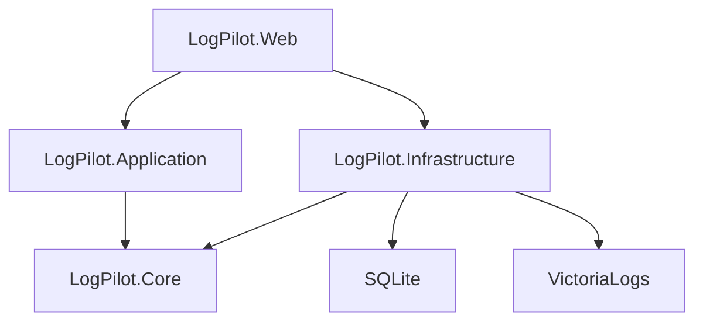
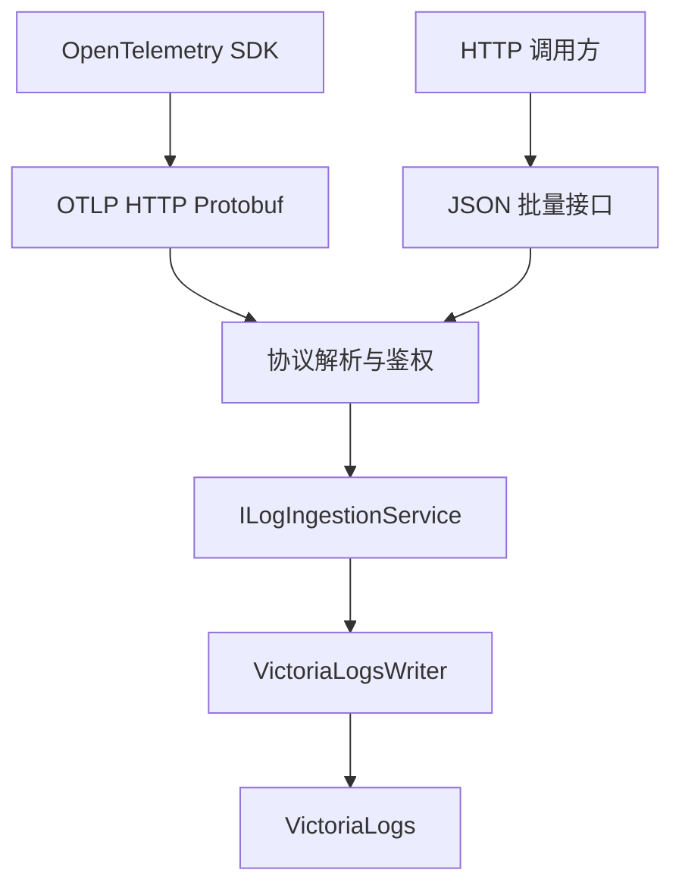
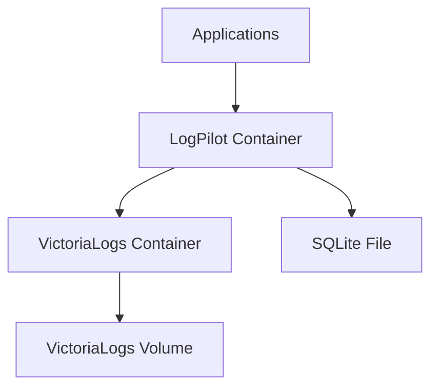

# LogPilot V0.1 项目结构与开发规范

> 文档编号：04  
> 版本：V1.0（对应 LogPilot 产品 V0.1 / 总体技术方案 V2.7）  
> 日期：2026-10-13  
> 状态：开发基线草案  
> 适用范围：GitHub 开源仓库、服务端、MVC 页面、数据访问、测试和持续集成  
> 图表约束：兼容 Typora Mermaid 8.14.0，使用基础 `graph TD` / `graph LR` 语法。

## 1. 目标、原则与范围

LogPilot 是轻量、易部署、易使用的自托管日志管理平台。后端采用 **ASP.NET Core 8 MVC + Web API**，页面采用 **Razor Views + 原生 JavaScript 渐进增强（不强制前端框架）**，配置数据采用 **SQLite + Dapper + Microsoft.Data.Sqlite**，实际日志由 **VictoriaLogs** 保存和检索。使用 **OpenTelemetry SDK + OTLP/HTTP Protobuf** 作为推荐接入方式，兼容 **HTTP JSON 批量接入**。默认运行 **LogPilot + VictoriaLogs 两个 Docker 容器**，不要求 RabbitMQ、Redis、MySQL、ClickHouse 或独立 Node 前端服务。

开发规范应服务于产品目标，而不是为了分层而分层。V0.1 使用可理解的**模块化单体**；不拆微服务，不自研消息队列，不自研完整日志存储引擎。数据库访问以明确 SQL 为主，依赖通过 DI 注入，全部外部调用都可以被测试替换。

### 1.1 必须遵守的架构底线

1. 接口接收、业务用例、数据访问、外部日志存储分离；Controller 不直接拼 SQL 或调用 VictoriaLogs HTTP API。
2. SQLite 保存管理元数据（用户、项目、应用、Key、迁移版本），**不保存持续产生的原始日志**。
3. OTLP 与 JSON 接入走不同协议适配器，但进入同一个经过认证和限流的 `ILogIngestionService`。
4. 每个接入凭据只能写入被授权的项目；项目 ID 从已验证的凭据解析，不信任请求体里自报的项目 ID。
5. 任何查询都强制附加服务端授权范围和时间范围；不能将浏览器提交的 LogsQL 直接送至 VictoriaLogs。
6. 客户端异步批量发送；服务端对写入成功的承诺必须与真实下游确认语义一致，不允许「仅内存入队」就假称持久化成功。
7. 默认两个容器：LogPilot 运行 ASP.NET Core、Razor 页面与静态资源和 SQLite；VictoriaLogs 运行日志引擎。
8. 首版先实现稳定闭环，告警高级功能、gRPC、Trace 可视化、集群部署按 PRD 的版本边界后续推进。

## 2. 技术栈与版本管理

| 模块 | 选型 | 版本策略 |
| --- | --- | --- |
| 运行平台 | ASP.NET Core | **8.0 LTS**，使用受支持的最新 8.0.x 安全补丁 |
| 开发 SDK | .NET SDK | 8.0 SDK 特性版本；通过 `global.json` 控制 roll-forward |
| Web | MVC + Web API + Razor | 与 ASP.NET Core 8 一致 |
| 数据访问 | Dapper | 锁定 NuGet 版本，不跟随浮动版本上线 |
| SQLite 驱动 | Microsoft.Data.Sqlite | **8.x**，保持与 .NET 8 兼容 |
| 配置数据库 | SQLite | 运行环境提供的 SQLite 3.x，开启 FK 和 WAL |
| 日志引擎 | VictoriaLogs | 方案基线 **v1.53.0**；正式发布前复核安全更新 |
| 页面交互 | 原生 JavaScript | 渐进增强，**不强制前端框架**；静态文件本地化 |
| UI 组件 | 按需选用轻量方案 | 仅在确有收益时引入，需本地托管并固定版本 |
| 图表 | ECharts | 6.x 系列，本地托管；图表进入版本范围时引入 |
| 通信 | OTLP/HTTP Protobuf | 遵循 OpenTelemetry 协议定义 |
| 辅助接入 | HTTP JSON | 自定义版本化批量接口 |
| 测试 | xUnit / ASP.NET Core TestHost | 按项目锁定版本 |
| Docker | Docker Engine + Compose v2 | 镜像锁定具体 tag，发布流程可采用 digest 固定 |

**不把具体补丁号写死为永久版本**。仓库维护 `Directory.Packages.props`（推荐中央包管理）、NuGet 锁文件、前端本地静态资源的版本/校验信息、`global.json`、基础镜像 tag，更新时提交 PR 并执行回归测试。首版 Razor 页面使用原生 JS 渐进增强，可以不引入 Vite；如果将来引入前端构建，Node 仅在构建阶段使用。

## 3. 推荐 GitHub 仓库结构

```text
logpilot/
├── LogPilot.sln
├── global.json
├── Directory.Build.props
├── Directory.Packages.props
├── README.md
├── README.zh-CN.md
├── LICENSE
├── CONTRIBUTING.md
├── SECURITY.md
├── .editorconfig
├── .gitignore
├── .github/
│   └── workflows/
│       ├── build-test.yml
│       └── docker-publish.yml
├── src/
│   ├── LogPilot.Web/                  # 唯一 ASP.NET Core Web 进程
│   │   ├── Controllers/               # Razor MVC 控制器
│   │   ├── ApiControllers/            # /api/v1 和 /v1/logs
│   │   ├── Middleware/
│   │   ├── Filters/
│   │   ├── Views/
│   │   │   ├── Shared/
│   │   │   ├── Dashboard/
│   │   │   ├── Logs/
│   │   │   ├── Projects/
│   │   │   └── Integrations/
│   │   ├── wwwroot/
│   │   │   ├── css/
│   │   │   ├── js/
│   │   │   │   ├── pages/
│   │   │   │   └── components/
│   │   │   └── lib/                  # 本地第三方静态文件（如 ECharts）
│   │   ├── appsettings.json
│   │   ├── appsettings.Development.json
│   │   └── Program.cs
│   ├── LogPilot.Core/                 # 领域模型、契约、端口
│   │   ├── Models/
│   │   ├── Contracts/
│   │   ├── Enums/
│   │   └── Abstractions/
│   ├── LogPilot.Application/          # 应用用例、协议映射、验证
│   │   ├── Ingestion/
│   │   ├── Logs/
│   │   ├── Projects/
│   │   ├── Identity/
│   │   └── Validation/
│   └── LogPilot.Infrastructure/       # 实际外部依赖实现
│       ├── Sqlite/
│       │   ├── Repositories/
│       │   ├── Migrations/
│       │   └── SqliteConnectionFactory.cs
│       ├── VictoriaLogs/
│       │   ├── VictoriaLogsClient.cs
│       │   ├── VictoriaLogsWriter.cs
│       │   └── VictoriaLogsQuery.cs
│       ├── Authentication/
│       └── DependencyInjection.cs
├── tests/
│   ├── LogPilot.UnitTests/
│   ├── LogPilot.IntegrationTests/
│   ├── LogPilot.ContractTests/
│   └── LogPilot.LoadTests/
├── examples/
│   ├── dotnet-otel/
│   ├── java-otel/
│   ├── python-otel/
│   └── curl-json/
├── deploy/
│   ├── compose.yml
│   ├── .env.example
│   └── Dockerfile
└── docs/
    ├── 00_完整技术方案_V2.7.md
    ├── 01_LogPilot_V0.1_产品需求文档_PRD.md
    ├── 02_LogPilot_V0.1_SQLite与VictoriaLogs_数据库设计.md
    ├── 03_LogPilot_V0.1_API接口设计.md
    └── 04_LogPilot_V0.1_项目结构与开发规范.md
```

**注意：项目数量是代码组织边界，不是容器数量**。部署时 `LogPilot.Web` 发布成果包含其他程序集和静态页面。

## 4. 依赖方向和模块职责



| 层 | 可以做 | 禁止做 |
| --- | --- | --- |
| Web | 路由、认证入口、DTO、模型校验、MVC 页面 | 在 Controller 中写 LogsQL、直连 SQLite |
| Application | 用例编排、项目隔离、接入规范化、查询条件验证 | 依赖 MVC、HTTP 客户端具体类 |
| Core | 日志记录模型、接口、领域规则 | 引用 Dapper、Sqlite 或 ASP.NET Core |
| Infrastructure | Dapper 仓储、迁移、VictoriaLogs HTTP 客户端 | 隐藏业务越权规则、直接决定前端行为 |

推荐 DI 统一注册；应用层依赖 `ILogStore`、`IProjectRepository`、`IApiKeyVerifier` 等抽象，实现由基础设施层提供。不要为了形式而创建大量空接口：**接口需要带来可替换、可测试或隔离外部边界的价值**。

## 5. MVC、Web API 与前端开发规范

### 5.1 路由分工

- 页面：`/logs`、`/projects`、`/integrations` → MVC Controller 返回 Razor View。
- 管理 API：`/api/v1/logs/search`、`/api/v1/projects` 等 → JSON。
- 标准 OTLP：`POST /v1/logs` → **符合 OTLP Protobuf 规范的响应**。
- 简易写入：`POST /api/v1/ingest/logs` → LogPilot JSON 响应。
- 运行探针：`/health/live` 与 `/health/ready`。

### 5.2 前端渐进增强

- Razor 负责布局、静态资源引用、用户页面入口和防伪信息。
- 原生 JS 负责日志过滤、列表、详情抽屉、异步加载和交互；复杂交互可逐步模块化，避免在 `.cshtml` 中堆大量内联 JS。
- 图表等第三方静态资源放在 `wwwroot/lib/` 并固定来源版本，不依赖公网 CDN。
- 前端不保存可写入项目的长期 API Key；后台使用登录 Cookie 管理会话。
- Razor 注入到 JS 的动态数据必须进行正确 JSON 编码，避免 XSS。
- 表单修改、Cookie 认证 API 按 ASP.NET Core 反伪造策略保护；避免关闭 CSRF 校验换方便。

### 5.3 服务端与前端示例

```csharp
[Route("logs")]
public sealed class LogsController : Controller
{
    [HttpGet("")]
    public IActionResult Index() => View();
}

[ApiController]
[Route("api/v1/logs")]
public sealed class LogsApiController : ControllerBase
{
    private readonly ILogQueryService _service;
    public LogsApiController(ILogQueryService service) => _service = service;

    [HttpPost("search")]
    public async Task<IActionResult> Search(
        [FromBody] LogSearchRequest request,
        CancellationToken ct)
    {
        var result = await _service.SearchAsync(request, User, ct);
        return Ok(result);
    }
}
```

此示例用于说明分层，不包含完整鉴权特性、DTO 定义与 DI 注册，不能直接当作生产可运行代码。

### 5.4 前端交互规则

- 所有查询必须显示 loading、空结果、失败、超时状态。
- 点击“查询”后只更新当前数据区域，避免整页刷新。
- 条件改变时取消旧请求（`AbortController`），避免较慢响应覆盖新结果。
- 日志列表展示发生时间、服务、级别、摘要；详情展示结构化属性和可复制原文。
- 大字段（异常堆栈）默认折叠；消息文本默认作为文本渲染，禁止不受控 `v-html`。
- 实时日志功能未上线时，原型界面标记为规划能力，不做无响应的按钮。

## 6. SQLite + Dapper 规范

### 6.1 文件、连接与 PRAGMA

- SQLite 路径通过配置指定，如 `/data/logpilot.db`，Docker 挂载独立持久化目录。
- 禁止将数据库放在镜像只读层或临时目录。
- 应用启动时执行版本迁移（建议使用独立迁移服务并加互斥锁），失败则拒绝进入就绪状态。
- 开启 `PRAGMA foreign_keys = ON`；启用 `journal_mode = WAL`，设置适当 `busy_timeout`。
- SQLite WAL 改善读取并发，但仍只有一个写事务能同时进行；元数据操作事务应尽量短。
- 备份使用 SQLite Backup API 或官方安全备份方式，不能只随意复制正在写入中的数据库主文件。

建议在连接工厂统一处理连接字符串和配置，避免每个仓储自行复制数据库初始化逻辑。`Microsoft.Data.Sqlite` 的异步 I/O 不代表真正的异步文件磁盘操作，性能测试必须测量数据库写锁等待。

### 6.2 SQL 规范

- 所有外部变量使用 Dapper 参数；SQL 不通过字符串拼接用户输入。
- 查询写明确列名，不用 `SELECT *` 作为长期公开接口的数据结构。
- 查询列表指定确定顺序和分页上限；写操作明确事务。
- 新增字段要包含相应迁移脚本，不直接修改历史已发布迁移。
- 时间统一 UTC 保存为固定格式或整数时间戳，仓储层做类型转换。
- `password_hash` 使用成熟的密码哈希方案，不存明文或简单 SHA256 密码哈希。
- API Key 使用密码学安全随机值，数据库只存密钥摘要和短前缀；签发时明文只显示一次。

```csharp
public sealed class SqliteProjectRepository
{
    private readonly ISqliteConnectionFactory _connections;

    public SqliteProjectRepository(ISqliteConnectionFactory connections)
        => _connections = connections;

    public async Task<ProjectRow?> FindByCodeAsync(string code)
    {
        using var db = _connections.Open();
        return await db.QuerySingleOrDefaultAsync<ProjectRow>(
            "SELECT id, code, name FROM lp_project WHERE code = @Code LIMIT 1",
            new { Code = code });
    }
}
```

### 6.3 迁移文件

```text
Infrastructure/Sqlite/Migrations/
  0001_initial.sql
  0002_add_project_settings.sql
```

迁移记录在专门的迁移表，按顺序单次执行，事务提交后才记录版本。兼容已有文档 `02_数据库设计.md` 的字段及命名；本文件不重复定义另一套相冲突的数据库模式。

## 7. OTLP / JSON 接入编码规范

### 7.1 两个入口，同一应用用例



- OTLP/HTTP 必须遵守 OpenTelemetry Proto 消息结构、Content-Type、成功/失败/部分成功语义。
- JSON API 可以使用自定义返回结构，但必须维护清晰的版本契约。
- 规范化层统一处理时间、严重级别、service.name、trace_id、span_id、attributes。
- 主键/日志事件 ID 应在服务端或已可信来源统一生成/映射。
- 两个接入入口使用相同的项目鉴权、批次限额、敏感信息过滤基础能力和 VictoriaLogs 存储策略。
- 默认单批日志数、字节上限、压缩、429/503 背压语义采用 `03_API接口设计.md` 的约定；不要在不同模块硬编码不同值。

### 7.2 可靠性与响应

- 默认由客户端 SDK 执行有界异步批量导出，避免业务线程逐条同步发送。
- V0.1 服务端 **不引入** RabbitMQ/Kafka/自研内存确认队列；等待 VictoriaLogs 下游完成约定的接收确认再返回本次写入结果。
- 必须明确：下游 HTTP 成功不一定等同物理磁盘已执行完整 `fsync`；README 写明所提供的交付保证和恢复限制。
- 进程、网络或下游故障时清晰返回可重试错误；对于部分接受的 OTLP 批次遵守协议，不把部分成功包装为完全成功。
- 避免无限重试和内存无限积压；支持取消令牌、超时、指数退避和有界队列。
- 审计、支付等不能丢失的数据必须保存在业务事务数据库，不依赖普通应用日志管道做唯一记录。

## 8. VictoriaLogs 适配规范

### 8.1 数据与查询边界

- 所有实际日志的写入和搜索均通过 Infrastructure 适配器。
- 使用官方摄入 API，如 `/insert/opentelemetry/v1/logs` 或 `/insert/jsonline`（映射转换时），不要把未经适配的自定义 JSON 直接假定符合 VictoriaLogs 格式。
- 查询走 `/select/logsql/query`，查询条件构造由后端封装，绝不直接执行未经校验的用户字符串。
- VictoriaLogs 中日志必须包含可信的 `project_id` 和 `service_name` 等规范字段。
- 必须针对所有查询路径测试项目过滤，特别是搜索、详情、导出、统计及实时查询。
- 结构化字段筛选和关键词匹配遵守 LogsQL 语义；中文子字符串搜索需要独立测试，不能把词元匹配当作任意字串匹配。
- HTTP 客户端通过 `IHttpClientFactory` 管理，内部地址由配置提供，生产默认不把 VictoriaLogs 端口暴露到公网。

### 8.2 适配器推荐抽象

```csharp
public interface ILogWriter
{
    Task<LogWriteResult> WriteAsync(
        IReadOnlyList<LogRecord> logs,
        CancellationToken cancellationToken);
}

public interface ILogSearcher
{
    Task<LogSearchResult> SearchAsync(
        AuthorizedLogQuery query,
        CancellationToken cancellationToken);
}
```

`AuthorizedLogQuery` 应包含服务端确认的项目范围，普通 Web DTO 不可直接转换为无限制 LogsQL。查询层必须限制时间跨度、扫描代价、结果条数和超时时间。

## 9. 认证、授权与基础安全规范

安全不作为复杂的商业隐私模块首发，但基本认证与隔离属于必须交付的基础质量：

1. 后台使用 ASP.NET Core Cookie 认证；写入 API 使用项目级 API Key；两种凭据用途隔离。
2. 浏览器不能读取长期接入 API Key，密钥签发明文只展示一次。
3. 项目成员关系与授权必须在服务端检查，不能只靠 UI 隐藏按钮。
4. 对 `LogPilot.Web` 接口实施请求体大小上限、限流、超时、日志字段大小上限。
5. 反向代理后正确配置 Forwarded Headers、HTTPS 和可信代理；生产关闭详细异常页面。
6. 明确跨域策略，默认不对任意来源放开凭据跨域请求。
7. LogPilot 自身不能把用户密钥、Cookie、完整认证头等打印到自己的业务日志。
8. SQLite 数据卷和 VictoriaLogs 数据卷应持久化，控制文件权限，并有恢复演练。

## 10. 错误处理、可观测性与健康检查

- 管理 API 统一使用 HTTP 状态码与规范化 JSON 错误响应（参照 03 文档）。
- OTLP 路由必须使用标准协议响应，不能统一套用 MVC 的错误包装。
- 应用日志至少包含 request_id、模块、耗时及异常类型，不输出敏感凭据。
- `liveness` 不检查外部数据库，以免依赖故障导致无谓反复重启。
- `readiness` 检查关键配置、SQLite 可用性和 VictoriaLogs 连通性，可为下游不可用返回不可就绪。
- VictoriaLogs 写入延迟、拒绝数、请求失败、查询超时应作为 LogPilot 自身的运行指标。
- 不强制接入第三个监控系统，V0.1 可用轻量健康接口与内部状态页。

## 11. 配置管理与 Docker 规范

建议使用 `appsettings.json` 默认值、环境变量覆盖与密钥文件机制。绝不将真实令牌、账号密码和生产连接地址提交到 GitHub。

```json
{
  "Storage": {
    "Sqlite": { "DataSource": "/data/logpilot.db" },
    "VictoriaLogs": { "BaseUrl": "http://victorialogs:9428" }
  },
  "Ingestion": {
    "MaxBatchRecords": 500,
    "MaxBodyBytes": 1048576,
    "RequestTimeoutSeconds": 10
  }
}
```

上述参数为初始**候选值**，不能替代真实压测或当前 API 设计文档的最终配置。生产环境端点使用 HTTPS 反向代理；VictoriaLogs 和 SQLite 数据目录由持久化卷提供。



- Docker 多阶段构建，运行镜像只保留 .NET ASP.NET Core Runtime、发布文件和最少所需运行依赖。
- `wwwroot` 直接托管本地静态资源与脚本（含图表库产物），不需要 Node 容器常驻。
- 运行时建议非 root 用户，提前准备可写数据卷及权限。
- 两容器分别设置健康检查、重启策略、资源观察及版本标签。
- `depends_on` 不等于下游就绪，LogPilot 应有指数退避的就绪检查。
- 不以「2 核 4GB」作为产品最低承诺；资源目标是轻量与可观测，具体最低规格由测试决定。

## 12. 编码风格与质量门禁

### 12.1 C# 风格

- 开启 `<Nullable>enable</Nullable>`、隐式 using、分析器和一致的 `.editorconfig`。
- 公共异步方法以 `Async` 结尾、接受合适的 `CancellationToken`。
- DTO 与存储行模型分离；日志模型对外字段命名统一。
- HTTP 请求不手动频繁创建 `HttpClient`；使用 `IHttpClientFactory`。
- 控制器薄、服务可测试；业务异常转换为稳定的状态码。
- 只在有实际业务意义时使用事务，不为只读查询开启写事务。

### 12.2 Git 与提交规范

- `main` 始终可构建；新功能从 `feature/*` 分支走 Pull Request。
- 推荐 Conventional Commits：`feat:`, `fix:`, `docs:`, `test:`, `refactor:`, `chore:`。
- PR 描述包含变更理由、影响范围、测试方法、兼容性风险与必要的界面截图。
- 不提交 `bin/`、`obj/`、SQLite 数据文件、日志数据目录、`.env` 私有配置。
- 推荐许可证 Apache-2.0，正式公开前核对依赖及图标素材的授权。

## 13. 测试体系

| 测试类型 | 必须覆盖的典型场景 | 是否 V0.1 必做 |
| --- | --- | --- |
| 单元测试 | 字段映射、权限范围、搜索条件、验证器 | 是 |
| SQLite 集成 | 迁移、约束、WAL 读写、Dapper 参数化 | 是 |
| VictoriaLogs 集成 | 批量写入、时间筛选、关键字、日志详情 | 是 |
| OTLP 协议契约 | Protobuf 解码、标准响应、部分成功、错误 | 是 |
| JSON API 契约 | 正常批量、无效记录、超限、鉴权失败 | 是 |
| Web E2E | 登录、搜索、详情、项目与 Key 操作 | 建议至少主路径 |
| 故障测试 | 下游不可达、重启、超时、重复发送 | 是 |
| 性能测试 | 持续写入 + 并发查询，记录资源占用 | 是（基线，不承诺固定吞吐） |

### 13.1 性能基线如何记录

不要仅写「1000 条/秒」。每次压测报告至少包含硬件、日志平均大小、日志字段数、索引/保留设置、发送批次、并发客户端、查询并发、运行时长、CPU/内存峰值、磁盘增长、吞吐、P50/P95/P99、失败率和丢弃率。比较不同版本时固定测试数据和负载。

### 13.2 CI 最小流程

```text
checkout
  -> dotnet restore --locked-mode
  -> dotnet format verify
  -> dotnet build --no-restore
  -> dotnet test
  -> security / dependency scan
  -> Docker image build
```

依赖锁文件在创建之后再启用 `--locked-mode`。VictoriaLogs 集成测试建议通过 Docker/Testcontainers 在支持容器的 CI Runner 上执行。

## 14. V0.1 分阶段实施与完成定义

| 迭代 | 交付物 | 验收标准 |
| --- | --- | --- |
| M1 工程基线 | 解决方案、依赖注入、MVC 空壳、CI | 本地和 CI 构建测试通过 |
| M2 配置数据 | SQLite 迁移、项目、用户、API Key | 可初始化、可恢复、权限隔离有效 |
| M3 写入闭环 | JSON API、OTLP/HTTP、VictoriaLogs 写入 | 两种方式写入并可搜索，错误可追踪 |
| M4 查询闭环 | 搜索、筛选、详情、时间范围 | 跨项目无法查看日志，页面主流程可用 |
| M5 开源交付 | Docker Compose、示例、README、压测 | 新开发者可按教程独立部署和接入 |

**V0.1 Done 定义：** 在两容器部署下，开发者无需编写 LogPilot 私有 SDK，任选 OpenTelemetry 标准 SDK 或 HTTP JSON 批量请求，能完成日志写入、认证查询及查看详情；故障有明确反馈，SQLite 和 VictoriaLogs 数据在容器重建后仍保留；安装文档能够被陌生开发者独立执行。

## 15. 架构决策记录（ADR）

| 编号 | 决策 | 原因 | 代价 |
| --- | --- | --- | --- |
| ADR-001 | .NET 8 MVC + Web API | 使用熟悉技术，页面和 API 同进程 | 需要清晰分隔管理与 OTLP 协议 |
| ADR-002 | Razor + 原生 JS 渐进增强（不强制前端框架） | 无前端常驻容器、无构建步骤，最贴合轻量化目标 | 复杂页面的交互组织需自律，确有收益时再引入轻量组件 |
| ADR-003 | SQLite + Dapper | 管理数据少、依赖低、SQL 可控 | 写事务串行，迁移需自管 |
| ADR-004 | VictoriaLogs | 日志专用存储、全文检索与统计 | 需要学习 LogsQL，测试中文搜索 |
| ADR-005 | SDK OTLP/HTTP 优先 | 跨语言标准、客户端批量能力成熟 | 必须正确实现 OTLP 协议契约 |
| ADR-006 | HTTP JSON 辅助 | 兼容遗留系统与脚本 | 多维护一个接入 DTO |
| ADR-007 | 两 Docker 容器 | 易分离升级和故障定位 | 仍需管理两份镜像及数据卷 |
| ADR-008 | 不引入 RabbitMQ | 轻量部署 | 故障重试主要依靠 SDK/可选采集器 |

## 16. 与其他文档的关系和变更规则

- **01 PRD** 决定版本范围与用户验收；开发规范不能擅自扩展 MVP。
- **02 数据库设计** 是字段、索引和迁移的唯一权威来源；本文件只描述使用方式。
- **03 API 设计** 是路径、请求和响应格式的唯一权威来源；实现改变应同步更新接口文档。
- **05 UI 设计（待生成）** 描述页面详细状态与交互。
- **06 部署测试（待生成）** 描述生产可执行的 Compose、环境变量和压测操作。

任何影响数据兼容性、接口行为、部署组件数量或日志交付语义的变更，都需要更新技术方案版本和变更日志。不要仅改源码、文档滞后。

## 17. 官方参考

- ASP.NET Core MVC：https://learn.microsoft.com/aspnet/core/mvc/overview
- Microsoft.Data.Sqlite：https://learn.microsoft.com/dotnet/standard/data/sqlite/
- Dapper：https://github.com/DapperLib/Dapper
- OpenTelemetry OTLP：https://opentelemetry.io/docs/specs/otlp/
- VictoriaLogs：https://docs.victoriametrics.com/victorialogs/
- SQLite WAL：https://www.sqlite.org/wal.html
- ECharts：https://echarts.apache.org/
- Docker Compose：https://docs.docker.com/compose/

---

**本文件用于规范 V0.1 开发，最终代码实施前，必须结合已生成的 01–03 文档核对字段与接口契约。**
