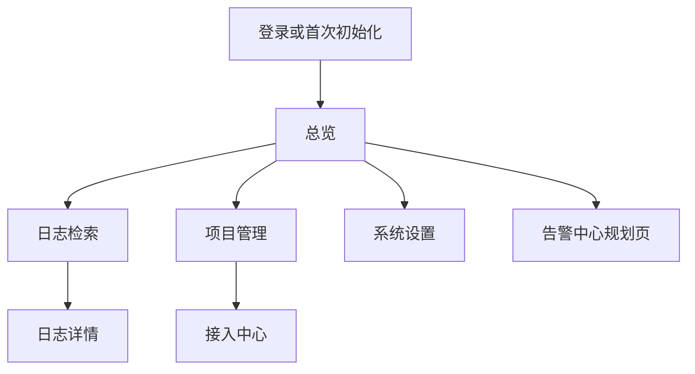
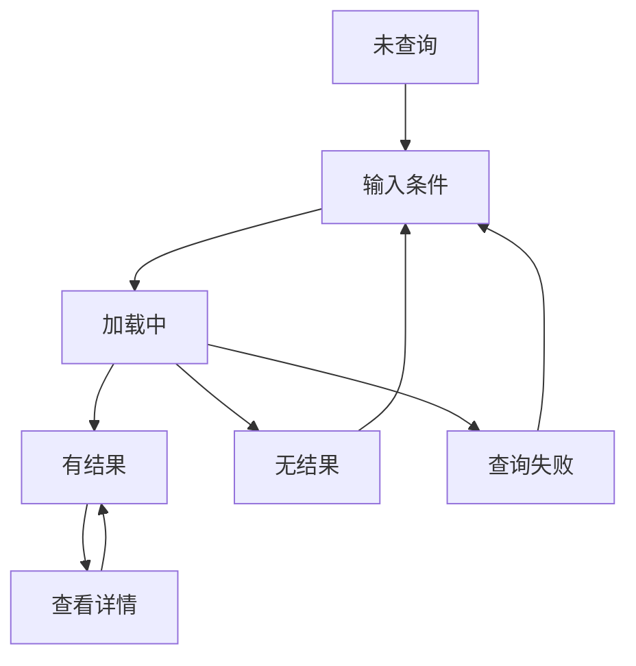
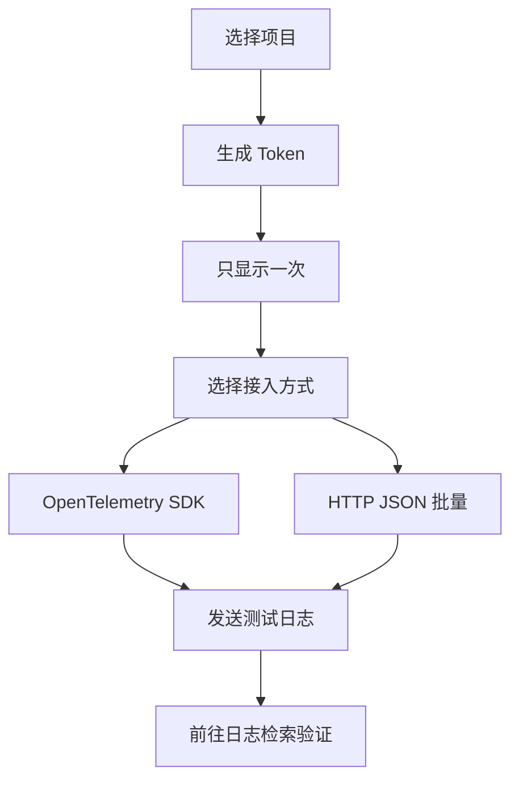

# LogPilot V0.1 UI 页面详细设计

> 文档编号：05 ｜版本：V0.1｜日期：2026-10-13｜状态：待开发基线  
> 对应文档：`01_LogPilot_V0.1_产品需求文档_PRD.md`、`02_LogPilot_V0.1_SQLite与VictoriaLogs_数据库设计.md`、`03_LogPilot_V0.1_API接口设计.md`、`04_LogPilot_V0.1_项目结构与开发规范.md`  
> 参考原型：`LogPilot_管理后台_交互原型_V0.1.html`（纯前端模拟数据，不代表真实后端已实现）

## 1. 文档目标及产品原则

本文件把现有 HTML 原型转换为可以开发、联调和验收的页面规范；**不扩大 V0.1 的开发范围**。

产品优先级依次为：**轻量化、部署简单化、使用方便化**。基础的认证、凭证保护和项目隔离属于必要安全要求，但 V0.1 不开发复杂的隐私治理产品。

- 服务器：ASP.NET Core 8 MVC + Web API，同一个 LogPilot 容器承载 Razor 页面、Vue 3 静态脚本和管理 API。
- 数据层：SQLite + Dapper 管理元数据；VictoriaLogs 保存业务日志，作为第二个 Docker 容器。
- 客户端：Vue 3 渐进式集成 Razor；不要求运行时 Node.js，也不独立部署 SPA 容器。
- 日志发送：OpenTelemetry SDK + OTLP/HTTP Protobuf 为首选；HTTP JSON 批量为辅助。
- 所有用户可见数字、日志、项目、接入状态均必须来自真实接口；演示环境须显著标记“演示数据”。

## 2. 版本与页面范围

| 页面 | V0.1 | 未来版本 | 设计说明 |
|---|---|---|---|
| 首次安装与管理员初始化 | P0 | — | 仅在系统尚无管理员时开放 |
| 登录/退出 | P0 | — | 会话过期和错误提示 |
| 总览 | 基础版 P0 | V0.2 趋势 | 连接状态、项目选择、入口；高级趋势不承诺 |
| 日志检索 | P0 | V0.2 实时 SSE | 项目、时间、服务、级别、关键词、TraceId |
| 日志详情 | P0 | — | 原始 JSON、异常堆栈、复制 |
| 项目管理 | P0 | — | 创建、编辑、停用 |
| 接入中心/API Key | P0 | — | 一次展示 Token、SDK 与 HTTP 示例 |
| 系统设置/诊断 | 基础版 P0 | V0.2+ | 版本、依赖状态、必要诊断，不展示敏感配置 |
| 告警中心 | 占位 | V0.3 | 禁止呈现可用的“测试告警”假操作 |
| 实时日志、趋势图、异常归并 | 不实现 | V0.2+ | 原型中的演示模块仅作为视觉参考 |

### 2.1 V0.1 信息架构



> Mermaid 图仅使用 `graph TD`、基础节点和箭头，兼容 Typora Mermaid 8.14.0。

## 3. 全局布局与视觉规范

### 3.1 页面骨架

- 桌面版：左侧导航约 220–240px；顶部为当前位置、项目切换、账号菜单；右侧内容区最大宽度建议 1500px。
- 移动/窄屏：导航可收起为抽屉；内容可纵向滚动；日志表允许横向滚动或切换卡片展示。
- 首版采用浅色主题，优先清晰度与信息密度，暗色主题可后续添加。
- 使用统一页面标题、说明、副操作区、筛选栏、内容表格、分页及错误提示。
- 按钮：主要动作用实心强调色；危险操作采用确认弹窗；禁用态必须说明原因。

### 3.2 建议设计 Token

| Token | 建议值 | 使用场景 |
|---|---|---|
| 页面背景 | `#F5F7FB` | 主工作区 |
| 内容背景 | `#FFFFFF` | 卡片、表格、对话框 |
| 正文 | `#182339` | 标题与数据 |
| 次级文本 | `#66758A` | 说明、占位 |
| 边框 | `#E7EBF1` | 分隔线 |
| 品牌强调色 | `#496FF5` | 主按钮、选中态 |
| 成功 | `#16A376` | 已连接、正常 |
| 错误 | `#E44D5D` | Error、失败 |
| 警告 | `#D99725` | Warn、风险 |
| 基础圆角 | 8–13px | 按钮和卡片 |

以上色值延续现有 HTML 原型作为建议，不强制使用某套重型前端框架。字体优先系统字体。状态不仅依赖颜色，必须同时展示文字。

### 3.3 组件规范

**通用组件：** `AppShell`、`ProjectSelector`、`PageHeader`、`SearchToolbar`、`StatusBadge`、`LoadingState`、`EmptyState`、`ErrorState`、`ConfirmDialog`、`CopyButton`、`Pagination`、`LogLevelBadge`、`JsonViewer`。

- 加载：筛选切换时应显示局部 loading，保留筛选条件，不应整页白屏。
- 反馈：成功轻提示；失败显示简短错误 + 可操作的重试入口；不要把异常堆栈直接暴露给普通页面。
- 无权限：显示“无权查看该项目”，不泄露项目日志数量或服务名称。
- 文案与时间：中文为默认语言；时间在页面展示为浏览器本地时间，悬停或详情提供 UTC 原始时间。
- 可访问性：按钮可通过键盘操作，输入框有 label，对话框支持 ESC 关闭和焦点管理。

## 4. 页面一：首次初始化与登录

### 4.1 首次初始化 `/setup`

**前提：** SQLite 中还不存在管理员账号。此时仅开放初始化所需路由；创建成功后关闭初始化入口。

页面字段：管理员账号、密码、确认密码。提示密码最小强度要求和数据存储目录是否可写。提交中禁用重复点击。

状态：未初始化 / 初始化中 / 初始化成功 / 失败（已初始化、数据库不可写、请求过期）。服务端必须保证仅能初始化一次，不能仅依赖隐藏按钮。

### 4.2 登录 `/account/login`

字段：账号、密码；功能：登录、错误反馈、退出及登录状态失效跳转。

- 登录失败统一文案，避免泄露账号是否存在。
- Cookie 使用 HttpOnly、SameSite 并在 HTTPS 环境下启用 Secure；表单及敏感管理操作要有 CSRF 防护。
- 已登录用户访问登录页可返回总览；会话失效时提示并跳转。

## 5. 页面二：总览 `/`

**V0.1 只实现轻量总览，不能承诺尚未实现的历史趋势图或告警结果。**

页面内容：

1. 当前项目名称、快速切换入口（无可访问项目则提示创建或联系管理员）。
2. 服务健康卡片：LogPilot API 状态、VictoriaLogs 可连接状态，采样时间。
3. 快捷操作：“查询日志”“创建项目”“配置接入”。
4. 可选小型概览：最近 15 分钟日志条数及 Error 数；如果查询成本高或统计接口未就绪，可以不显示，不能使用假数据。
5. 告警功能仅显示“计划中（V0.3）”。

| UI 状态 | 显示行为 |
|---|---|
| 正常 | 绿色连接状态 + 最近检查时间 |
| 数据库不可用 | 明确提示存储不可用，不显示伪正常 |
| 无项目 | 空状态与创建/申请权限指引 |
| 统计超时 | 健康状态和统计分开显示；统计可单独重试 |

关联接口：健康诊断端点、`GET /api/v1/stats/overview`（如实现基础统计）、项目列表。

## 6. 页面三：日志检索 `/logs`

这是 V0.1 最重要的页面，应优先开发。

### 6.1 查询区域

| 控件 | 默认 | 行为 |
|---|---|---|
| 项目 | 最近使用的有权限项目 | 必选；切换后重置分页 |
| 时间 | 最近 15 分钟 | 快捷：15m、1h、24h；可自定义 UTC 区间 |
| 服务 | 全部 | 可选择服务，来源必须受项目权限约束 |
| 级别 | 全部 | Trace/Debug/Info/Warn/Error/Fatal 等标准化显示 |
| 关键词 | 空 | 支持消息与异常内容检索；回车提交 |
| TraceId | 空 | 高级筛选；保留完整精确值 |
| 查询按钮 | 可用 | 显式执行；请求期间禁用重复提交 |
| 重置 | — | 清空筛选，恢复 15m 范围 |

- 项目变更、时间变更、筛选变更时，统一重置分页/游标。
- 关键词不能未经转义直接插入 LogsQL；由服务端进行字段白名单和参数/安全查询构造。
- 禁止普通用户输入任意 LogsQL 后透传到 VictoriaLogs；高级查询功能后续单独评估。
- URL 可以保存非敏感筛选条件以方便分享，但绝不把 Token 放入 URL。

### 6.2 日志列表

建议列：`时间` / `级别` / `服务` / `消息摘要` / `TraceId（可隐藏）` / `详情`。

- 按事件时间降序，默认每页 50 条，上限 100 条。
- 消息单行省略，保留完整内容的详情入口；长堆栈不直接渲染到整行。
- 统一使用本地时间展示，详情提供 UTC 精度。
- 未查到结果：显示搜索条件及“修改时间范围/清除筛选”入口。
- 查询失败：保留上次结果时标明其不是本次最新结果，并提供重试；不能静默展示过期数据。
- 大量日志分页：按 API 文档使用安全游标/时间锚点；如果后端无法保证稳定翻页，限制为“加载更早”而不是承诺任意深度页码。

### 6.3 详情交互

点击行或“详情”，右侧抽屉（桌面）或全屏弹层（移动）显示：

- 事件 ID、事件时间、接收时间（如有）、服务、项目、级别。
- `message` 完整内容与换行保留。
- TraceId、SpanId、异常类型、异常消息、堆栈（字段不存在显示“无”）。
- 自定义属性键值对、原始 JSON（折叠显示，长字段按需展开）。
- “复制消息”“复制 TraceId”“复制 JSON”；复制动作必须反馈成功/失败。

不允许将日志消息作为 HTML 直接插入 DOM，Vue 默认转义文本；堆栈、属性等均作为普通文本展示，防止日志内容注入。

### 6.4 查询与详情状态机



### 6.5 API 对应

- `POST /api/v1/logs/search`：执行搜索。
- `GET /api/v1/logs/{id}`：详情（以 API 03 定义的定位能力为前提）。
- `GET /api/v1/logs/filters`：候选服务、级别。
- `GET /api/v1/logs/context`：如首版实现“查看上下文”，需受时间及数量限制。

## 7. 页面四：项目管理 `/projects`

### 7.1 项目列表

字段：项目名称、唯一编码、说明、状态、可执行操作。列表不直接展示 Token。

操作：创建、编辑、停用、前往日志、前往接入中心。

### 7.2 创建/编辑

| 字段 | 校验 |
|---|---|
| 名称 | 必填，最大长度按数据库和 API 文档 |
| 编码 | 必填，唯一；建议小写字母、数字和短横线；创建后原则上不可修改 |
| 说明 | 可选，有长度限制 |
| 状态 | 启用/停用；停用需要二次确认 |

停用项目后对应 Token 不可继续写入；既有日志是否仍可按保留策略查看，由后端业务规则控制并在 UI 中明确说明。

普通用户不可编辑无权限项目；按钮隐藏仅是界面优化，服务端必须校验。

## 8. 页面五：接入中心 `/integrations`

**V0.1 同时支持两条真实接入路径，SDK 是默认首选。**

### 8.1 接入流程



### 8.2 Token 设计

- 创建前选择项目及有效期，提交后一次性展示密钥，可复制。
- 提供“我已安全保存”确认；关闭后无法再次显示明文，只可撤销并新建。
- 密钥表格仅显示名称、前缀、创建时间、过期时间、最后使用时间、状态、撤销。
- 不能将 Token 放到 URL、前端持久化存储或客户端日志；复制时不打印控制台。

### 8.3 SDK 接入选项卡

默认选中“OpenTelemetry SDK（推荐）”。提供语言切换：`.NET`、`Java`、`Python`；其他语言提供通用 OTLP 环境变量说明链接/示例。

示例重点：

```text
OTEL_EXPORTER_OTLP_LOGS_ENDPOINT=https://your-host/v1/logs
OTEL_EXPORTER_OTLP_LOGS_PROTOCOL=http/protobuf
```

必须提示：还需要安装/启用对应语言的日志导出器、配置批量处理器和认证 Header。仅设置环境变量不代表 SDK 一定会自动采集日志。Header 格式需按语言 SDK 分别说明。

### 8.4 HTTP JSON 接入选项卡

- 展示 POST 地址、Bearer Token Header、批量 JSON 示例及 cURL 示例。
- 说明由调用方自行实现合批、重试和超时控制，不推荐业务线程逐条同步请求。
- 示例默认使用脱敏假 Token，不能把真实 Token 写入 GitHub 示例。

### 8.5 验证和排障

- 提供“复制测试命令”以及“打开日志检索并带入当前项目/最近 15 分钟”。
- `401`：凭证问题；`403`：项目权限；`413`：请求体过大；`429`：限流；`5xx`：接收端或存储故障。
- OTLP Protobuf 的响应格式与业务 JSON API 不同；页面只能把响应解释为对应协议定义的语义，不能一概提示“HTTP 200 = 所有日志已永久保存”。

## 9. 页面六：系统设置与健康 `/settings`

V0.1 仅提供只读基础诊断及必要配置说明：

- LogPilot 版本、VictoriaLogs 服务可连接性、检测时间。
- SQLite 数据文件/挂载目录的存在性与可写状态（不显示绝对敏感路径或密码）。
- 日志写入失败计数、最近故障概览（如果后端有真实数据）。
- 文档链接、备份与恢复说明、默认保留策略的说明。

VictoriaLogs 的真实保留策略应从实际部署配置读取或明确注明“配置文件声明值”；不要将 UI 表单改动伪装成已即时生效。

## 10. 告警中心 `/alerts`：仅规划占位

V0.1 显示标题、简短说明及“计划在 V0.3 支持”的状态，不提供伪造的触发次数、不提供看似可以保存但无后端的规则编辑器。

未来版本预计包含：错误阈值、冷却时间、通知渠道、规则列表、历史事件、恢复通知。须以独立 PRD/接口版本推进。

## 11. UI 与接口的统一状态和错误规范

| 场景 | 前端处理 | 验收要求 |
|---|---|---|
| 网络超时 | 保留输入，提示超时和重试 | 不误报查询无结果 |
| `401` 未登录 | 返回登录，必要时保留安全的回跳地址 | 不暴露敏感路径 |
| `403` 无权限 | 显示无访问权 | 不展示项目数据 |
| `404` 日志不存在 | 显示日志不存在或已过保留期 | 弹层可关闭 |
| `413` 请求太大 | 接入中心说明缩小批次 | 不无限重试 |
| `429` 请求过多 | 展示限流与 Retry-After（若有） | 不自动造成重试风暴 |
| `5xx` 存储故障 | 提示服务不可用，允许重试 | 不误报成功 |
| 空字段 | 显示“无”或不展示该行 | 页面无脚本异常 |
| 超长日志 | 文本截断展示 + 详情展开 | 不造成布局崩坏 |

## 12. MVC + Vue 3 实现落地

### 12.1 约定路由

| Razor 页面路由 | 对应模块 |
|---|---|
| `/setup` | 初始化 |
| `/account/login` | 登录 |
| `/` | 总览 |
| `/logs` | 日志查询 |
| `/projects` | 项目管理 |
| `/integrations` | 接入中心 |
| `/settings` | 基础诊断 |
| `/alerts` | 功能规划页 |

Web API 的正式路径与 DTO 以文档 03 为准，不从前端随意新增接口。

### 12.2 前端组织建议

```text
LogPilot.Web/
  Views/
    Shared/_Layout.cshtml
    Home/Index.cshtml
    Logs/Index.cshtml
    Projects/Index.cshtml
    Integrations/Index.cshtml
    Settings/Index.cshtml
    Alerts/Index.cshtml
  wwwroot/
    css/site.css
    js/common/api-client.js
    js/common/ui-feedback.js
    js/pages/logs.js
    js/pages/projects.js
    js/pages/integrations.js
    js/pages/overview.js
    lib/vue/
    lib/element-plus/
```

建议用 Razor 负责页面框架，Vue 负责高交互区域；避免在同一个节点内同时由 Razor 和 Vue 反复修改内容。Vue 等静态文件本地托管，不依赖公共 CDN。

### 12.3 状态与 API 约束

- 每个页面 Vue 应用独立挂载，首版不引入复杂全局状态管理。
- `api-client.js` 统一封装请求超时、凭证策略、错误展示；Cookie 会话与项目接入 Token 分离。
- 查询取消：更换过滤条件后取消旧请求或忽略旧响应，防止结果覆盖。
- 以 DTO 映射 UI，不把 VictoriaLogs 原始响应直接传到浏览器。
- 所有展示日志的组件对内容做文本转义，避免 XSS。

## 13. 响应式及无障碍验收

- 1440px、1024px、768px、390px 四种视口检查布局。
- 390px 下能完成登录、项目选择、搜索日志、查看详情、复制接入示例。
- Tab 键可到达主要按钮，Enter 可执行搜索，ESC 可关闭详情弹层。
- Dialog 焦点不能停留在遮罩下方控件。
- 重要状态含文字，不仅以红绿颜色区分。
- 长英文堆栈及中文混排不超出主视口，JSON 区域允许滚动。

## 14. 开发优先级与依赖关系

| 顺序 | 页面/组件 | 前置依赖 | 完成定义 |
|---|---|---|---|
| 1 | 基础布局、登录、初始化 | 会话 API、SQLite | 能登录进入空总览 |
| 2 | 项目管理 | 项目 API | 能创建、编辑、停用 |
| 3 | Token 和接入中心 | 密钥 API、双接入后端 | 能复制示例并真实写入日志 |
| 4 | 日志检索 | 搜索 API、筛选 API | 能按条件查询且权限隔离 |
| 5 | 日志详情 | 详情 API/日志定位方案 | 能安全展开、复制 JSON |
| 6 | 基础总览、设置诊断 | 健康 API | 正确显示存储状态 |
| 7 | 边界场景和响应式 | 以上全部 | 错误、空态、移动端可用 |

## 15. UI 验收清单

- [ ] 未初始化环境只出现管理员初始化入口；不能重复初始化。
- [ ] 未登录不能访问管理页面和 API。
- [ ] 多项目切换后不会保留其他项目日志结果。
- [ ] 能通过 OpenTelemetry SDK 把日志写入并在页面检索。
- [ ] 能通过 HTTP JSON 批量请求写入并在页面检索。
- [ ] 日志默认查询最近 15 分钟，并支持服务、级别、关键词、TraceId 筛选。
- [ ] 分页遵循后端真实稳定性边界；不会出现虚假的无限分页。
- [ ] 日志详情能展示堆栈和原始 JSON，复制成功有反馈。
- [ ] Token 只展示一次，撤销后无法继续接入。
- [ ] 健康异常时显示错误，不使用模拟正常状态。
- [ ] 告警中心明确写明未实现，不能执行伪操作。
- [ ] 低分辨率浏览器、键盘操作、长文本场景均通过测试。
- [ ] 所有请求失败不影响已输入条件，也不泄露服务端内部堆栈。

## 16. 与 HTML 原型的关系及后续修订

原型文件 `LogPilot_管理后台_交互原型_V0.1.html` 用于演示视觉和部分交互，存在模拟数据、模拟项目创建、规划中的告警卡片。**开发时以本文 + PRD + API 文档为准**。如果将原型升级到联调版，应删除虚假的真实感数据或强制显示 Demo 标志，并将所有操作连接到后端接口。

下一份文档：`06_LogPilot_V0.1_Docker部署与测试方案.md`，详细定义双容器部署、数据卷、初始化、备份、升级、监控、可靠性与性能测试。
